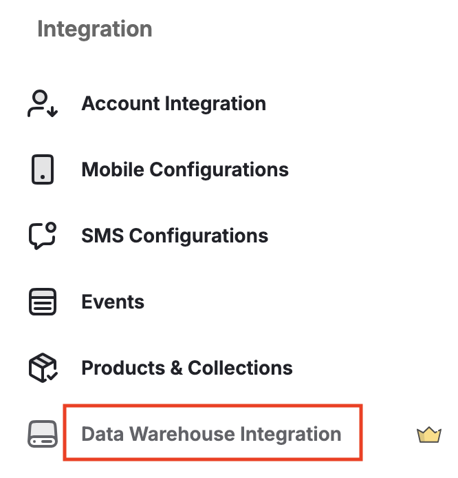
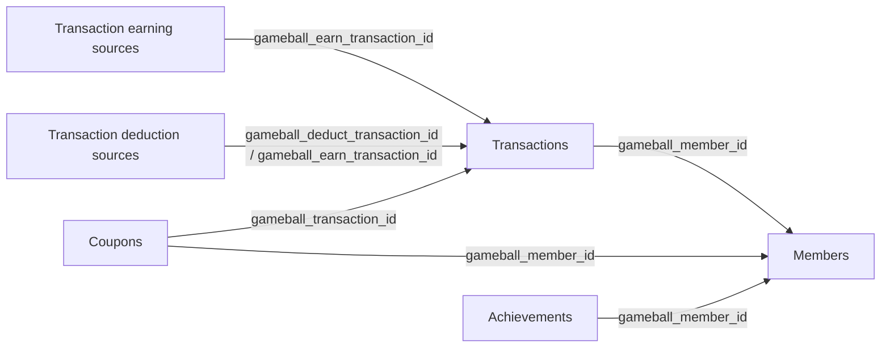

## Plan Availability

<Tabs>
  <Tab title="Non-platform">
    | Plan | Available |
    |---|---|
    | All | Yes |
  </Tab>
  <Tab title="Shopify">
    | Plan | Available |
    |---|---|
    | All | Add-on |
  </Tab>
  <Tab title="Salla">
    | Plan | Available |
    |---|---|
    | All | Add-on |
  </Tab>
</Tabs>

The **Data Warehouse Ingestion Module** pushes your loyalty data into your own data warehouse, so you can combine it with data from your other systems and report on everything in one place. This article explains how to set it up, what each shared table holds, and how to answer the most common questions from the tables so your numbers match your Gameball dashboard.

---

## Overview

Most large businesses store their operational data in a **data warehouse**, which acts as a single source of truth. Order management, inventory, CRM and communication tools push their data into it, and an analytics tool (such as PowerBI or Metabase) reads from it to build dashboards.

With the Data Warehouse Ingestion Module, Gameball becomes part of this setup. You can:

- Combine loyalty data with revenue, inventory and customer communication data
- Build cross-system dashboards in one place
- Run advanced analysis without relying only on Gameball's in-dashboard reports

| System | Data Pushed |
|---|---|
| Order / POS system (e.g. Microsoft Dynamics) | Revenue and order data |
| Inventory management system | Stock and product data |
| Customer engagement platform (e.g. Braze) | Communication and campaign data |
| Gameball | Loyalty and rewards data |

For example, by joining **order data** from your POS system with **transaction data** from Gameball, you can build one dashboard that shows revenue and the points earned on the same orders, revenue by loyalty tier, or how loyalty actions relate to repeat purchases.

---

## How to Set Up the Integration

<Steps>
  <Step title="Open Data Warehouse Integration">
    Go to **Admin Settings** in the Gameball dashboard, then navigate to **Data Warehouse Integration** and click **Set Up Connection**.

    <Frame>
      
    </Frame>
  </Step>

  <Step title="Select Data Warehouse Provider">
    Choose your data warehouse provider (for example, Amazon Redshift), then click **Next**.
  </Step>

  <Step title="Add Connection Details">
    Enter the required account and connection details, then click **Next**.
  </Step>

  <Step title="Define Data Push Frequency">
    Choose how often Gameball should push data:

    - Daily
    - Weekly
    - Monthly

    You also define the exact time (for example, daily at midnight).

    <Warning>
      Higher frequencies come with higher costs.
    </Warning>
  </Step>

  <Step title="Select Data Models">
    Choose which Gameball tables you want to push: Transactions, Members, Transaction earning sources, Transaction deduction sources, Coupons and Achievements.
  </Step>

  <Step title="Submit Request">
    Once submitted, the request is sent to Gameball's technical team.
  </Step>
</Steps>

---

## What Happens After Submission

The connection is **not established automatically**.

| Stage | Detail |
|---|---|
| Initial submission | Acts as a configuration and request flow |
| Technical setup | Gameball's technical team manually completes the integration |
| Connection live | Status changes to **Connected** |
| Ongoing pushes | Each scheduled push appears in the dashboard with its status and details |

---

## Before You Start

Five rules apply to every table. Most numbers that don't match the dashboard break one of them.

1. **Remove deleted rows.** Keep only rows where `is_deleted` = 0. A row that is voided on Gameball's side is never removed from your copy; it is sent again with `is_deleted` = 1.
2. **Convert times to your program's time zone.** Every timestamp is in UTC. The dashboard groups days and months in your program's time zone, so add your offset before grouping (for example +3 hours for Riyadh). Without it, a few hours at each month edge land in the wrong month.
3. **Check how fresh your copy is.** Your copy is as recent as its last sync. The latest `updated_at` in a table tells you when that was; anything after it is not in your copy yet, while the dashboard is live.
4. **Join on the Gameball ids.** Columns starting with `gameball_` are Gameball's ids and join the tables to each other. Join customers on `gameball_member_id`, not `customer_unique_id`: the same customer id can sit on more than one Members row when a customer was deleted and added again. `customer_unique_id`, `transaction_id` and `order_id` are your own ids.
5. **Points vs money.** Points columns are counts of points. A money value is points × `redemption_factor` in your currency (with a factor of 0.01, 100 points = 1 SAR). `points_value` already holds that amount.

---

## How the Tables Connect

Every table joins to Members on `gameball_member_id` (new). The two sources tables join to Transactions on `gameball_transaction_id`, which they call `gameball_earn_transaction_id` (the earning) and `gameball_deduct_transaction_id` (the deduction).



---

## Available Data Models

Gameball shares **six tables** with your data warehouse. You choose which ones to enable during setup.

<Note>
**New columns**: Columns marked **(new)** arrive with the next update of the tables.
</Note>

<AccordionGroup>
  <Accordion title="Transactions" icon="arrow-right-arrow-left">
    One row per points movement: every time a customer gains points (`direction` = +) or loses them (`direction` = −). It is the main table for earned, redeemed, expired and outstanding points.

    | Column | What it holds |
    |---|---|
    | `gameball_transaction_id` | Gameball's id for the movement. Joins to the two sources tables. |
    | `transaction_id` | Your own id for the order or event behind it. |
    | `customer_unique_id` | Your id for the customer. |
    | `gameball_member_id` **(new)** | Gameball's id for the customer. Joins to Members. |
    | `merchant_unique_id`, `branch_unique_id` | Your ids for the merchant and branch where it happened. Empty when no branch was sent with the activity. |
    | `transaction_type` | What the movement is (types below). |
    | `direction` | + for points gained, − for points lost. `points_amount` is always positive. |
    | `earning_source` | How points were earned, in short: Cashback, Achievement Campaign, Level/Tier, Referral, Manual, Refund, Migration. Earned rows only. |
    | `tier_name`, `tier_order` | The customer's tier at the time of the movement. |
    | `paid_amount` | Money paid on the order that earned points; on a cancellation, the amount returned to the customer. |
    | `points_amount` | Points moved. |
    | `points_used_amount` | Earned rows only: how many of these points have since left the wallet (redeemed, expired, cancelled or deducted). |
    | `redemption_factor`, `points_value` | Money value per point and the movement's money value (rule 5). |
    | `transaction_status` | Earned rows only: Active (spendable) or Pending (not spendable yet). Shows today's status. |
    | `points_expiry_date` | Earned rows only: when the remaining points of this row expire. |
    | `created_at` | When the movement happened (UTC). Use it for dates. |
    | `updated_at` | When the row last changed. Use it only to check freshness. |
    | `is_deleted` | 1 = voided. Always keep 0 only. |

    **Transaction types**

    | Direction | Type | Meaning |
    |---|---|---|
    | + | Payment Reward | Cashback earned on a purchase. |
    | + | Achievement Reward | Points from a campaign, tier reward or referral. |
    | + | Manual Accumulation | Points added by hand from the dashboard or API. |
    | + | Refund Points | Points given back when an order paid with points is refunded. |
    | + | Migration | Balances brought over from a previous program. |
    | − | Redemption | Points spent at checkout. |
    | − | Discount Code | Points exchanged for a discount code. |
    | − | Expiry | Points that reached their expiry date unused. |
    | − | Full Canceled Points, Partial Canceled Points | Points taken back because the order that earned them was cancelled or returned, fully or in part. |
    | − | Manual Deduction | Points removed by hand. |
  </Accordion>

  <Accordion title="Members" icon="users">
    One row per customer, as they are today: profile, tier, referral details and current balances. Balances here are today's only; for any past date use Transactions.

    | Column | What it holds |
    |---|---|
    | `gameball_member_id` | Gameball's id for the customer. Every other table carries it: join on it. |
    | `customer_unique_id` | Your id for the customer. It can repeat when a customer was deleted and added again with the same id. |
    | `display_name`, `date_of_birth`, `gender` | Profile details. |
    | `customer_type` | Registered (full profile) or Guest (limited profile). |
    | `is_migrate` | 1 = brought over from a previous program. |
    | `referred_by_unique_id`, `referral_activation_date`, `is_referred_customer` | Who referred the customer, when the referral was confirmed, and 1 if they were referred. |
    | `customer_tier_name`, `customer_tier_order`, `tier_entry_date` | Current tier and the date they entered it. |
    | `customer_points` | Points the customer can spend now (active). |
    | `customer_pending_points` | Points earned but not spendable yet. |
    | `total_earned_points`, `total_redeemed_points`, `total_expired_points` | Lifetime totals kept by the platform. They can differ slightly from summing Transactions; use Transactions for exact figures. |
    | `customer_score` | Score used for tiers when your tiers are based on score, not points. |
    | `is_included` | 0 = the customer was excluded from the program. An excluded customer cannot earn new rewards but keeps their points, which still expire and can be deducted. The dashboard counts them in every figure, so don't filter on this column to match it. |
    | `tags` | Tags the customer has today. |
    | `created_at` | When the customer joined (UTC). |
    | `updated_at` | When the row last changed. For a deleted customer, the closest date to when they were deleted. |
    | `is_deleted` | 1 = the customer was deleted from the program, or is a record the platform does not count. |

    A customer's available balance = `customer_points` + `customer_pending_points`.
  </Accordion>

  <Accordion title="Transaction earning sources" icon="arrow-trend-up">
    One row per part of an earning: an earned transaction is split into what produced its points (a cashback rule, a campaign, a tier reward, a product line). The rows of one earning add up to that earning's `points_amount` in Transactions.

    | Column | What it holds |
    |---|---|
    | `gameball_earning_source_id` | Gameball's id for the row. |
    | `gameball_earn_transaction_id` | The earning it belongs to. Joins to `gameball_transaction_id` in Transactions. |
    | `customer_unique_id`, `order_id` | Your ids for the customer and the order (empty when the earning is not from an order). |
    | `gameball_member_id` **(new)** | Gameball's id for the customer. Joins to Members. |
    | `earning_source`, `earning_source_id` | What produced the points: General, Tier, Collection, Product, Variant or Custom Cashback; Campaign Cashback (the extra points a multiplier campaign added); Achievement Campaign; Level/Tier; Referral; Achievement; Refund; Migration; Manual. |
    | `gameball_cashback_rule_id`, `cashback_rule_name` | The cashback rule (cashback rows only). |
    | `gameball_campaign_id`, `campaign_name` | The campaign (campaign rows only). |
    | `gameball_tier_id`, `tier_name`, `tier_order` | The tier (tier rows only). |
    | `product_id`, `product_name`, `quantity`, `price`, `discount` | The product line (cashback rows with order details only). |
    | `multiplier`, `points_per_unit` | The campaign multiplier, and points per unit = `earned_points` ÷ `quantity`. |
    | `earned_points` | Points this part contributed. |
    | `earned_at` | When the earning happened (UTC). |
    | `updated_at`, `is_deleted` | As in every table. |
  </Accordion>

  <Accordion title="Transaction deduction sources" icon="arrow-trend-down">
    One row per pair of a deduction and the earning it drew from: when 500 points are redeemed from two earlier earnings, there are two rows. It answers "which earned points were used".

    | Column | What it holds |
    |---|---|
    | `gameball_deduction_source_id` | Gameball's id for the row. |
    | `gameball_deduct_transaction_id` | The deduction (redemption, expiry, cancellation or manual deduction). Joins to `gameball_transaction_id` in Transactions. |
    | `gameball_earn_transaction_id` | The earning the points came from. Joins to `gameball_transaction_id` in Transactions and to Transaction earning sources. |
    | `customer_unique_id` | Your id for the customer. |
    | `gameball_member_id` **(new)** | Gameball's id for the customer. Joins to Members. |
    | `deduction_type` | redeemed, expired, cancelled or manual. |
    | `deducted_points` | Points taken from that earning by that deduction. |
    | `deducted_at` | When the deduction happened (UTC). |
    | `updated_at`, `is_deleted` | As in every table. |

    For period totals, use Transactions. The deduction sources totals can be lower, because a redemption that was later refunded is not counted as used points.
  </Accordion>

  <Accordion title="Coupons" icon="ticket">
    One row per coupon given to a customer. A multi-use code has one row per use: its own row is the first use, and every later use is a new row given and used at that moment.

    | Column | What it holds |
    |---|---|
    | `gameball_unique_id` | Gameball's id for this coupon row. |
    | `coupon_code` | The code the customer types at checkout. A multi-use code appears on one row per use. |
    | `customer_unique_id` | Your id for the customer who received it. |
    | `gameball_member_id` **(new)** | Gameball's id for the customer. Joins to Members. |
    | `coupon_type` | Fixed, Percentage, Free Shipping, Free Product, Store Credit, Buy X Get Y and others. |
    | `coupon_source` | Where it is used or came from: Online, POS, Permanent, Reward Campaign, Automation. |
    | `coupon_sub_source` | Why it was given: Points Redemption, Reward Campaign, Level, Referral Reward, Automation. |
    | `amount` | The discount: an amount for fixed types, a percentage for percentage types (10 = 10%). |
    | `max_discount` **(new)** | Cap on a percentage discount, in your currency. Empty when there is no cap. |
    | `min_order_value` **(new)** | Minimum order value for the coupon to apply. |
    | `usage_limit`, `is_multi_use` **(new)** | How many times the code can be used in total, and 1 when that is more than once. |
    | `coupon_group_name`, `campaign_name` **(new)** | The coupon group, and the campaign that gave the coupon. |
    | `order_id` **(new)** | Your order id the coupon was used on. Empty when not used, or when your orders don't carry the code. |
    | `total_paid_amount` | Money paid on that order. |
    | `points_spent` **(new)** | Points the customer paid for the coupon, when it was bought with points. Only on the code's own row. |
    | `gameball_transaction_id` **(new)** | The Discount Code transaction that paid those points. Joins to Transactions. |
    | `current_state` | assigned (not used yet), held (reserved at an open checkout), used, expired or deleted. |
    | `created_at` | When the coupon was given to the customer (UTC). |
    | `used_at` **(new)** | When it was used (UTC). |
    | `expires_at` **(new)** | When it expires or expired (UTC). |
    | `held_at` **(new)** | When it was reserved at a checkout (UTC). |
    | `updated_at` | When the row last changed. |
    | `is_deleted` | 1 = the coupon row was withdrawn, for example returned on a refund. |

    `total_order_count` is removed: with one row per use, count used rows instead.
  </Accordion>

  <Accordion title="Achievements" icon="trophy">
    One row per achievement a customer reached: a purchase reward, a campaign completed, a tier reached, a referral or a manual award.

    | Column | What it holds |
    |---|---|
    | `gameball_achievement_id` | Gameball's id for the achievement. |
    | `customer_unique_id` | Your id for the customer. |
    | `gameball_member_id` **(new)** | Gameball's id for the customer. Joins to Members. |
    | `achievement_type` | The detailed kind: Purchase Reward, Challenge, Level, Leveling Down, Referral, Referred, Challenge Manually, Manual Leveling-up and others. |
    | `achievement_sub_type` | The broad group: Transaction, Campaign, Level, Referral, Manual. |
    | `campaign_name` | The campaign, when there is one. |
    | `is_coupon_rewarded` | 1 = a coupon was given with it. |
    | `current_tier_name`, `current_tier_order` | The customer's tier at the time. |
    | `achieved_tier_name`, `achieved_tier_order` | The tier reached, for tier achievements. |
    | `achieved_points`, `points_value` | Points given and their money value. |
    | `achieved_score` | Score given, when tiers are based on score. |
    | `created_at` | When it was reached (UTC). |
    | `updated_at`, `is_deleted` | As in every table. |

    For points totals use Transactions, not `achieved_points`: Transactions also holds cashback, manual and refund points, and every deduction.
  </Accordion>
</AccordionGroup>

---

## Answering Common Questions

### Points earned, redeemed and expired in a period

All of these come from Transactions: keep `is_deleted` = 0, convert `created_at` to your time zone, keep the rows inside your period, and add up `points_amount` for the rows below.

| You want | Keep rows where | Dashboard card |
|---|---|---|
| Points earned | `direction` = + (every type) | Total accumulated points |
| Points redeemed | `transaction_type` = Redemption or Discount Code | Redeemed points |
| Points expired | `transaction_type` = Expiry | Expired, in Deducted points by type |
| Points cancelled | `transaction_type` = Full Canceled Points or Partial Canceled Points | Cancelled, in Deducted points by type |
| Points removed by hand | `transaction_type` = Manual Deduction | Manual deduction, in Deducted points by type |
| All points lost | `direction` = − (every type) | Total deducted points |

**Split by channel or store.** Use `branch_unique_id` and `merchant_unique_id`. They hold the branch and merchant you sent with the activity, and are empty when none was sent. Which branches count as online, and whether an empty branch means online, depends on how your integration sends orders.

**Split by how points were earned.** Use `transaction_type` or `earning_source` on the earned rows.

<Warning>
- **Earned is every + type.** Cashback alone leaves out achievements, manual additions, refund points and migration, and comes out lower than the dashboard.
- **Refund Points are earned (+).** They are points given back to the customer. Points taken back from a returned order are Full or Partial Canceled Points (−).
- **Redeemed has two types.** Points spent at checkout (Redemption) and points exchanged for a discount code (Discount Code). The dashboard's redeemed card counts both.
- **A large expiry in one month can be a catch-up.** Points are expired when the expiry job runs; if it ran late, points due over several months expire on the same day. To see when points were due, group the earned rows' `points_expiry_date` instead.
- **Deleted and excluded customers still count here.** The earned, redeemed and expired cards include their movements; only the balance leaves deleted customers out.
</Warning>

### Outstanding balance

Outstanding points (the dashboard's **Total available points**) are the points customers hold: everything earned, minus everything that left the wallet for any reason.

```text
Outstanding points = sum of points_amount on all + rows − sum of points_amount on all − rows
```

In Transactions, count every row from the start of your program.

| You want | How | Dashboard card |
|---|---|---|
| Available now | Members: sum of `customer_points` + `customer_pending_points` | Total available points |
| Active now (spendable) | Members: sum of `customer_points` | Total active points |
| Pending now (not spendable yet) | Members: sum of `customer_pending_points` | Total pending points |
| Available on a past date | Transactions: + minus − for every row created before that moment | Total available points, with that date picked |
| Change over a month | Opening balance + earned − all points lost in the month = closing balance | — |
| Money value (liability) | Points × your `redemption_factor` | "Equivalent to" line under each card |

<Warning>
- **Earned − redeemed − expired is too high.** Cancelled points and manual deductions also reduce the balance. Subtract every − type.
- **The dashboard shows the balance at the start of the date you pick.** To match it for 31 October, count transactions created before 00:00 on 31 October in your time zone. The end-of-day balance is the next day's figure.
- **Active and pending only exist for today.** `transaction_status` and Members' balances show today's state, so a past date gives the available total only.
- **Don't use `points_used_amount` for a past date.** It shows how many points have been used up to today, not up to that date.
- **Leave out deleted customers.** The dashboard balance does not count customers deleted from the program (Members `is_deleted` = 1). Drop their transactions, matched on `gameball_member_id`. For a past date, Members `updated_at` is the closest date to when they were deleted.
- **Keep excluded customers.** Customers with `is_included` = 0 still hold their points and count in the balance.
</Warning>

### Points expiring soon

Points that will expire in the next N days are the unused part of active earned rows whose expiry date falls in that window. The dashboard's expiring card uses the next 15 days.

In Transactions, keep rows where `direction` = +, `is_deleted` = 0, `transaction_status` = Active and `points_expiry_date` is after now and within the window. Add up `points_amount` − `points_used_amount`.

<Warning>
- **Use what is left, not what was earned.** A row of 1,000 points with 600 already redeemed can only expire 400.
- **Leave pending points out.** Their expiry date is provisional until they become active, so they are not counted as expiring.
- **Expiry dates are in UTC.** Convert them to your time zone before cutting a window by day.
- **Leave out deleted customers**, as for the balance.
</Warning>

### Where points came from and where they went

Transaction earning sources says what produced each earning; Transaction deduction sources says which earnings each redemption, expiry or cancellation used. Both join to Transactions on `gameball_transaction_id`.

| You want | How |
|---|---|
| Points earned by source (cashback rule, campaign, tier, referral, product) | Earning sources: add up `earned_points` by `earning_source`, `cashback_rule_name`, `campaign_name`, `tier_name` or `product_name`. |
| The same for a period or a channel | Join to Transactions on `gameball_earn_transaction_id` and filter on its `created_at` and `branch_unique_id`. |
| Extra points a multiplier campaign added | Earning sources rows with `earning_source` = Campaign Cashback. |
| What happened to an earning | Deduction sources: add up `deducted_points` by `deduction_type` for its `gameball_earn_transaction_id`. Still held = its `points_amount` minus that sum. |
| Which earnings a redemption used | Deduction sources rows for its `gameball_deduct_transaction_id`. |
| Of the points a campaign gave, how many were redeemed or expired | Earning sources rows of the campaign, joined to deduction sources on `gameball_earn_transaction_id`. |

<Warning>
- **One earning can have several sources.** A purchase during a double-points campaign has a cashback row and a Campaign Cashback row. Deductions are recorded per earning, so to split them by source, share them in proportion to each source's `earned_points`.
- **Totals: use Transactions.** Earning sources adds up to within about 0.1% of earned points in Transactions. Deduction sources can be lower for redeemed and cancelled points, because a redemption that was later refunded does not count as used.
- **Count redemptions in Transactions.** A deduction has one row per earning it drew from, so counting its rows counts pairs, not redemptions.
</Warning>

### Coupons given, used and expired

All from Coupons, keeping `is_deleted` = 0. Each row is one coupon given to one customer, and each use of a multi-use code is its own row.

| You want | How |
|---|---|
| Coupons given in a period | Rows with `created_at` in the period. |
| Coupons used in a period **(new)** | Rows with `used_at` in the period. |
| Coupons expiring or expired in a period **(new)** | Rows with `expires_at` in the period and `current_state` assigned or expired. |
| State today | Rows by `current_state`: used, assigned (+ held), expired. |
| Coupons bought with points, and the points paid **(new)** | Rows with `points_spent` filled; add up `points_spent`. `gameball_transaction_id` links each to its Discount Code transaction. |
| Usage rate | Used rows ÷ all rows given, for the same group of coupons. |
| Orders and money from coupons | Used rows with an `order_id`; add up `total_paid_amount`. |

<Warning>
- **Multi-use codes: count rows.** Every use is its own row, so used rows = uses. `points_spent` sits on the code's own row only, so adding it up never counts a purchase twice.
- **Orders link only when your orders carry the code.** If your integration doesn't send the coupon code with the order, `order_id` and `total_paid_amount` stay empty even for used coupons.
- **Withdrawn coupons are deleted rows.** A coupon returned on a refund comes back with `is_deleted` = 1 and `current_state` = deleted; rule 1 removes it.
</Warning>

---

## Availability & Enablement

The Data Warehouse Ingestion Module is offered as an **add-on**.

<Steps>
  <Step title="Enable the Feature">
    The feature must be enabled on your account before use.
  </Step>
  <Step title="Coordinate with Your CSM">
    Coordinate with your Customer Success Manager to start the implementation process.
  </Step>
</Steps>

---

## Related Articles

<CardGroup cols={3}>
  <Card title="Configure Time Zone" icon="clock" href="/product-documentation/admin-settings/configure-time-zone">
    Set the time zone your dashboard groups days and months by.
  </Card>
  <Card title="Launch the Earn Program" icon="coins" href="/product-documentation/programs/loyalty-points-earn/launch-and-configure-your-earn-pointing-system">
    Configure how customers earn points.
  </Card>
  <Card title="Configure Redemption" icon="gift" href="/product-documentation/programs/loyalty-points-redeem/launch-and-configure-your-redeem-pointing-system">
    Set up how customers redeem their points.
  </Card>
</CardGroup>
