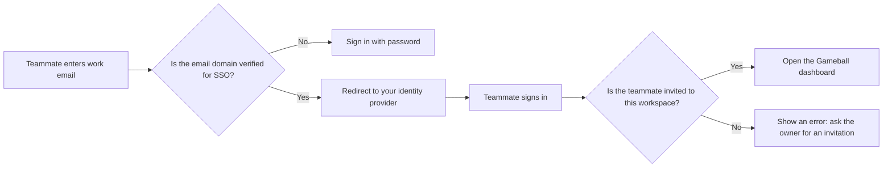

| Platform | Plan |
|---|---|
| Shopify | Plans that include Single Sign-On |
| Salla | Plans that include Single Sign-On |
| Non-platform Clients | Plans that include Single Sign-On |

<Note>
Single sign-on is a plan feature. If you don't see **Single sign-on** in your settings, contact [Support](mailto:support@gameball.co) to add it to your plan.
</Note>

**Gameball's Single Sign-On (SSO)** lets your team sign in to the Gameball dashboard with your company identity provider instead of a Gameball password. It uses OpenID Connect (OIDC) and works with Microsoft Entra ID, Okta, Google Workspace, and any other OIDC provider.

---

## How SSO Works

Gameball checks the domain of the email a teammate enters, sends them to your identity provider to sign in, and then opens the dashboard. Gameball never receives their company password.

<Info>
SSO does not create accounts. Every teammate must already be invited to your workspace. Invite them first, as described in [How to Create a New User](/product-documentation/admin-settings/create-user-assign-roles).
</Info>

---

## Before You Start

- Sign in as the **account owner**. Only the owner sees **Single sign-on** in the settings.
- Have admin access to your identity provider, so you can register Gameball as an application.
- Have access to your domain's DNS settings, so you can add a TXT record that proves you own your email domain.
- Use a company email domain. Public mailbox domains, such as Gmail or Outlook, and Gameball domains can't be used.

---

## Set Up SSO

Go to **Gameball dashboard** > **Settings** > **Single sign-on**. The setup wizard has five steps.

{/* IMAGE PLACEHOLDER: Screenshot of the Single sign-on settings page showing the five setup steps */}

<Steps>
  <Step title="Choose Your Provider">
    Select **Entra ID**, **Okta**, **Google Workspace**, or **Other OIDC**.

    The page shows the values you need to register Gameball in your identity provider. Each value has a copy button:

    - **Redirect URI**
    - **Scopes**
    - **Required claims**

    In your identity provider, create a new OIDC web application with this redirect URI. Then copy the **client ID** and **client secret** it gives you.

    {/* IMAGE PLACEHOLDER: Screenshot of the Provider step showing the redirect URI, scopes, and required claims with copy buttons */}
  </Step>

  <Step title="Enter the Connection Details">
    Fill in the following fields, then click **Save**:

    - **Authority**: your identity provider's issuer URL. It must start with `https://`.
    - **Client ID**: the ID from your identity provider.
    - **Client secret**: the secret from your identity provider.
    - **Display name**: the name your team sees on the sign-in page.

    Click **Test connection**. Gameball reads your provider's configuration and shows the issuer and the number of signing keys it found.

    <Note>
    The client secret is write-only. Gameball stores it encrypted and never shows it again. To change it, enter a new one and save.
    </Note>

    {/* IMAGE PLACEHOLDER: Screenshot of the Details step with a successful Test connection result */}
  </Step>

  <Step title="Verify Your Email Domains">
    Add each email domain your team uses, for example `company.com`. For each domain, Gameball shows a DNS TXT record:

    - **Host**: `_gameball-sso.<your-domain>`
    - **Value**: `gameball-sso-verification=<token>`

    Add the record at your DNS provider, then click **Verify**. The domain changes from **Pending** to **Verified**.

    <Warning>
    Every domain must be verified with a DNS record. Subdomains are not covered, so verify `team.company.com` separately from `company.com`. A domain can be verified for only one Gameball client.
    </Warning>

    {/* IMAGE PLACEHOLDER: Screenshot of the Email domains step showing a Pending domain with its TXT host and value */}
  </Step>

  <Step title="Run a Test Login">
    Click **Test login**. A new tab opens and sends you to your identity provider. After you sign in, you return to the settings page with a success or failure banner.

    A test login does not sign you in to Gameball. It only confirms that the connection works.

    {/* IMAGE PLACEHOLDER: Screenshot of the Test login step showing the success banner */}
  </Step>

  <Step title="Turn On the Switches">
    Use the switches at the bottom of the page:

    - **Enable**: lets your team sign in with SSO. It stays locked until you have a successful test login and at least one verified domain.
    - **Enforce**: requires SSO for your team. It stays locked until SSO is enabled and someone has signed in with SSO.
    - **Skip Gameball 2FA**: skips Gameball's two-factor prompt after an SSO sign-in, because your identity provider already handles it.

    {/* IMAGE PLACEHOLDER: Screenshot of the Switches step with Enable, Enforce, and Skip Gameball 2FA */}
  </Step>
</Steps>

---

## Enforce SSO

When you turn on **Enforce**, your teammates can no longer sign in with a password or with Google. Gameball asks you to confirm first.

<Warning>
You keep password access for **7 days** after you turn on enforcement, so you can recover if something goes wrong. After that, the owner must also sign in with SSO.
</Warning>

Enforcement applies to a teammate when their email domain is verified for your workspace, or when they have already signed in with SSO. A person who belongs to several clients is only blocked on the client that enforces SSO.

Gameball staff are never blocked by your enforcement settings.

<Tip>
Before you enforce, make sure you have signed in with SSO yourself. Gameball requires this so the owner can't be locked out.
</Tip>

### What Changes for Your Team

| Action | When SSO is enforced |
|---|---|
| Sign in with a password | Refused. The user is sent to the SSO sign-in page. |
| Sign in with Google | Refused. |
| Forgot password | No email is sent. The screen explains that your organization signs in with SSO. |
| Reset or change password | Refused. |
| Invite a teammate | The invitation email links to the SSO sign-in page instead of a set-password page. |

On the team list under **Settings** > **Accounts**, users who sign in with SSO show an **SSO** tag. While SSO is enforced, **Reset password** and **Resend invitation** are hidden.

---

## Sign In with SSO

<Steps>
  <Step title="Open the SSO Sign-In Page">
    On the Gameball login page, click **Sign in with SSO**.
  </Step>
  <Step title="Enter Your Work Email">
    Enter your work email and click **Continue**. If your domain has SSO set up, you are redirected to your identity provider.
  </Step>
  <Step title="Sign In to Your Identity Provider">
    Sign in as usual. You return to Gameball and land on the dashboard.
  </Step>
</Steps>

<Note>
If SSO isn't set up for your email domain, the page shows **Single sign-on isn't set up for this email**. Use **Sign in with password instead**, or ask your workspace owner.
</Note>

If your account isn't invited to the workspace, the page shows **Your account isn't registered in this Gameball workspace. Ask your workspace owner to invite you.**

---

## Turn Off or Remove SSO

- **Disable SSO**: turn off the **Enable** switch. You can't disable SSO while it is enforced, so turn off **Enforce** first.
- **Delete the configuration**: use the delete option at the bottom of the page and confirm. You can't delete it while it is enforced.
- **Change the provider**: you can't change the authority or client ID while SSO is enabled. Disable SSO first.

---

## Locked Out of Your Dashboard

If SSO is enforced and your team can't sign in, for example because your identity provider is unavailable, contact [Support](mailto:support@gameball.co). Gameball Support can turn enforcement off for your workspace so your team can sign in with passwords again. Support can only turn enforcement off. Turning it on stays with you.

---

## Common Questions

<AccordionGroup>
  <Accordion title="Who can set up SSO?">
    Only the account owner. Other roles, including admins, don't see the **Single sign-on** page.
  </Accordion>

  <Accordion title="Does SSO create user accounts automatically?">
    No. Users must be invited to your workspace first. When an invited user signs in with SSO for the first time, Gameball links their identity provider account to their dashboard account.
  </Accordion>

  <Accordion title="Why can't I verify my domain?">
    Check that the TXT record is on the exact host `_gameball-sso.<your-domain>`, that the value matches exactly, and that DNS changes have propagated. Public mailbox domains and domains already verified by another Gameball client can't be used.
  </Accordion>

  <Accordion title="Does Gameball support SAML?">
    Not yet. SSO currently supports OpenID Connect only.
  </Accordion>

  <Accordion title="Do my teammates still need Gameball two-factor authentication?">
    Only if you turn off **Skip Gameball 2FA**. By default, Gameball skips its own 2FA prompt after an SSO sign-in.
  </Accordion>

  <Accordion title="What happens if I remove Single Sign-On from my plan?">
    SSO is turned off for your workspace, and your team goes back to signing in with passwords.
  </Accordion>
</AccordionGroup>

---

## Related Articles

<CardGroup cols={2}>
  <Card title="Create Users and Assign Roles" icon="users" href="/product-documentation/admin-settings/create-user-assign-roles">
    Invite teammates and choose their roles before they sign in with SSO.
  </Card>
  <Card title="Track User Activity" icon="shield" href="/product-documentation/admin-settings/track-user-activity">
    Audit configuration changes across your workspace.
  </Card>
</CardGroup>
