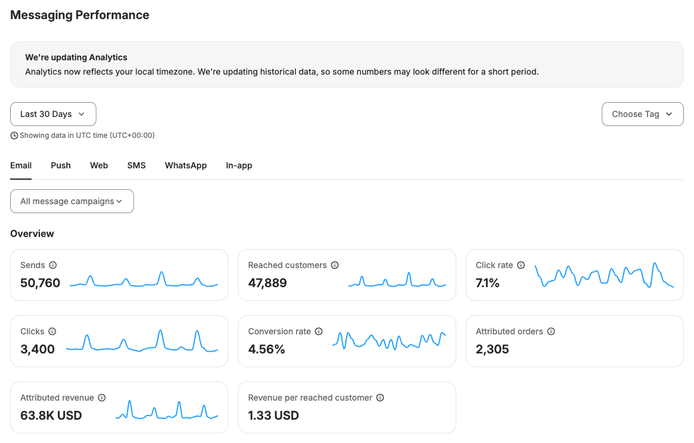
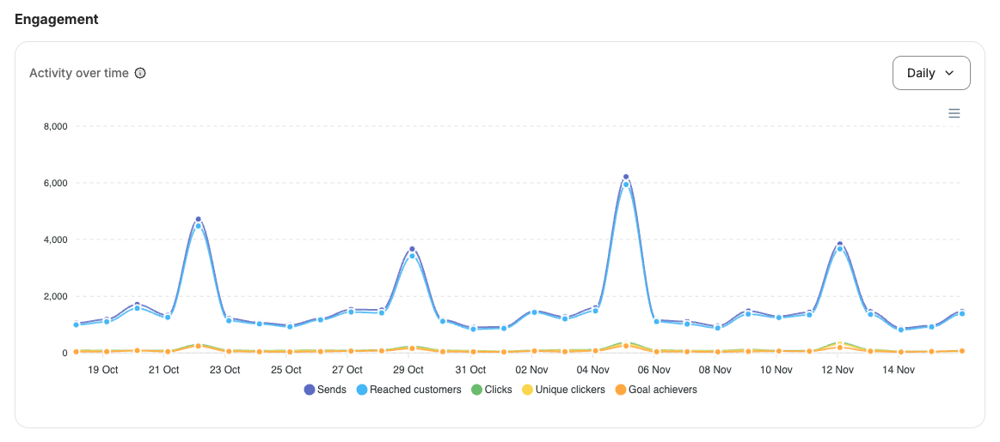
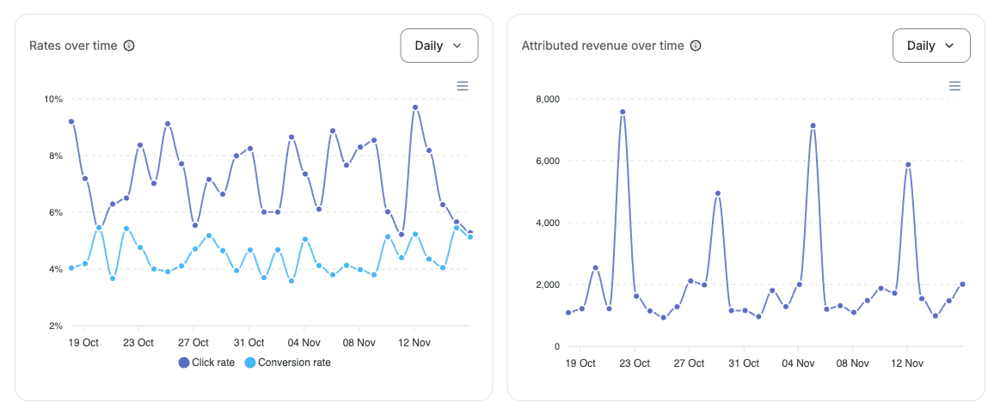
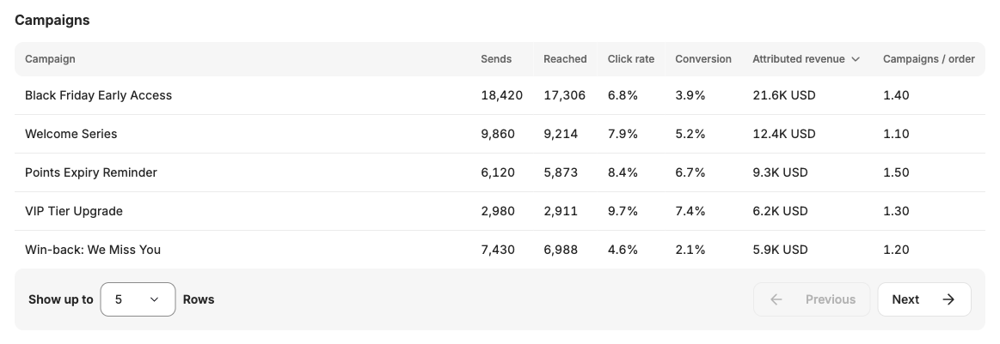

| Platform | Plan |
|---|---|
| Shopify | All Plans |
| Salla | All Plans |
| Non-platform Clients | All Plans |

**Messaging Performance** brings your outbound results together under Analytics, so you can compare channels and campaigns without opening each campaign. Each channel tab shows only the numbers that apply to it.

---

## Where to Find Messaging Performance

<Steps>
  <Step title="Open Analytics">
    Go to the **Gameball Dashboard** and click **Analytics** from the left bar.
  </Step>
  <Step title="Open Messaging Performance">
    Click **Messaging Performance**.
  </Step>
</Steps>

---

## Channel Tabs and Overview Numbers

Use the tabs to switch between **Email**, **Push**, **Web**, **SMS**, **WhatsApp**, and **In-app**. Each channel tab shows only the numbers that apply to it. The **Overview** section shows the main numbers for the selected channel at a glance. The page also has a date range filter, a tag filter, and a campaigns filter.

<Frame>

</Frame>

---

## Activity Over Time

The **Activity over time** chart in the **Engagement** section plots activity for the selected channel over time. You can switch the chart between time intervals, such as **Daily**.

<Frame>

</Frame>

---

## Rates and Attributed Revenue Over Time

Below the activity chart, **Rates over time** shows click rate and conversion rate, and **Attributed revenue over time** shows attributed revenue. Both charts can be switched between time intervals, such as **Daily**.

<Frame>

</Frame>

---

## Campaigns Table

The **Campaigns** table puts up to 10 campaigns side by side. Compare them by sends, impressions, reached customers, and conversion rate. Email, Web, and In-app also show clicks and click rate. Use the **Show up to** menu and the **Previous** and **Next** buttons to move through the list.

<Frame>

</Frame>

---

## Important Notes

<Note>
**Permissions**: The page is available to team members who can view both **Analytics** and **Communication**. [Learn more about roles](/product-documentation/admin-settings/create-user-assign-roles)
</Note>

---

## Common Questions

<AccordionGroup>
  <Accordion title="Why do some channels show fewer numbers?">
    Each channel tab shows only the numbers that apply to it. For example, clicks and click rate appear for Email, Web, and In-app campaigns.
  </Accordion>
  <Accordion title="How many campaigns can I compare?">
    The campaigns table puts up to 10 campaigns side by side.
  </Accordion>
</AccordionGroup>

---

## Related Articles

<CardGroup cols={2}>
  <Card title="Introduction to Communication Campaigns" icon="bullhorn" href="/product-documentation/communication-campaigns/introduction-to-communication-campaigns">
    Learn about the messaging channels you can send campaigns on.
  </Card>
  <Card title="Track Your Campaign Performance" icon="chart-line" href="/product-documentation/analytics/track-your-campaign-performance">
    Measure the reach and results of your reward campaigns.
  </Card>
</CardGroup>
