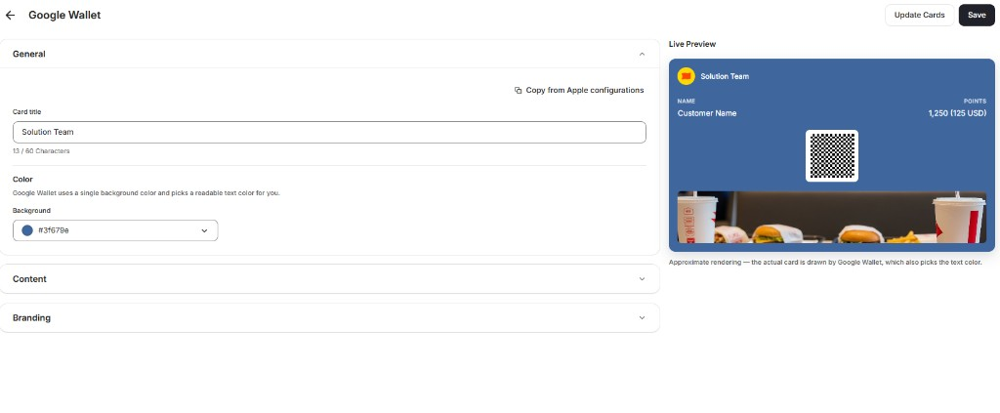
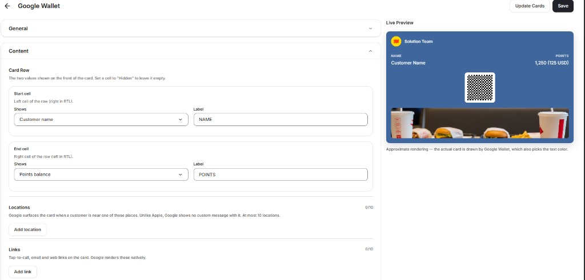
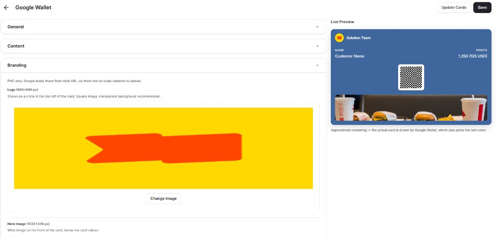
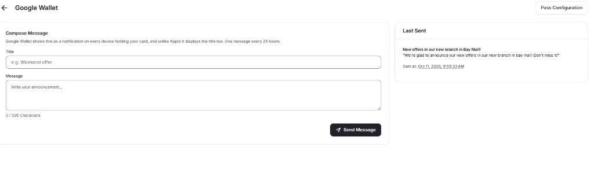

| Platform | Plan | Channel |
|---|---|---|
| All | Upon Request | Mobile |

**Gameball's Digital Wallet passes** let customers save their loyalty card to Apple Wallet or Google Wallet, so they can check their points balance and scan the card in-store without installing an app. You design the pass, choose where it appears on customers' phones, and send announcements to everyone holding it, all from the **Wallet** page in your dashboard.

<Note>
Digital Wallet passes are an add-on feature, available upon request. Contact [support@gameball.co](mailto:support@gameball.co) or your account manager to enable it for your account.
</Note>

---

## Benefits

- **Always accessible:** customers carry their loyalty card alongside their boarding passes, credit cards, and tickets.
- **Strengthen your brand:** the pass uses your logo, colors, and images.
- **Real-time updates:** points balance and tier update automatically whenever they change.
- **Location-based reminders:** the pass appears on the customer's phone when they are near one of your stores.
- **Direct broadcasts:** send a notification to every customer holding your pass, with no app or email list required.
- **In-store ready:** the pass can be scanned at checkout to earn or redeem points.

---

## How Do I Open the Wallet Settings?

Click **Wallet** in the dashboard sidebar. The page shows two cards:

- **Apple Wallet:** passes distributed to customers on iOS.
- **Google Wallet:** cards distributed to customers on Android.

Each card shows a preview of your current pass and two buttons: **Edit** to design the pass, and **Broadcast** to send a message to customers who hold it.

<Frame>
<!-- IMAGE PLACEHOLDER: Wallet page showing the Apple Wallet and Google Wallet cards, each with a pass preview and Edit and Broadcast buttons -->
</Frame>

---

## How Do I Design My Pass?

Apple Wallet and Google Wallet share the same settings. Click **Edit** on either card to open the editor. Settings are grouped into three sections (**General**, **Content**, and **Branding**), and a **Live Preview** on the right updates as you make changes.

<Steps>
  <Step title="Set the general details">
    Open the **General** section and configure:

    - **Card title:** the name shown at the top of the pass, up to 60 characters.
    - **Background color:** the color of the pass. Google Wallet uses a single background color and picks a readable text color for you.

    If you have already configured your Apple Wallet pass, click **Copy from Apple configurations** in the Google Wallet editor to reuse those settings instead of starting from scratch.

    <Frame>
    
    </Frame>
  </Step>
  <Step title="Choose what the pass shows">
    Open the **Content** section and configure:

    - **Card Row:** the two values shown on the front of the pass. For both the **Start cell** and **End cell**, choose what the cell **Shows** (for example, **Customer name** or **Points balance**) and enter the **Label** displayed above it. Set a cell to **Hidden** to leave it empty. In right-to-left languages, the start cell appears on the right.
    - **Locations:** up to 10 places where the pass appears on the customer's phone. See [Location-Based Notifications](#location-based-notifications).
    - **Links:** up to 10 tap-to-call, email, or web links shown on the pass.

    <Frame>
    
    </Frame>
  </Step>
  <Step title="Upload your branding">
    Open the **Branding** section and upload your images as PNG files:

    - **Logo (660×660 px):** shown as a circle in the top-left corner of the pass. Use a square image with a transparent background.
    - **Hero image (1032×336 px):** a wide image on the front of the pass, below the card values.
    - **Details banner:** a banner image shown in the pass details.

    <Frame>
    
    </Frame>
  </Step>
  <Step title="Save and update existing passes">
    Click **Save** to store your settings. Saving does not change the passes customers already have.

    To push your changes to every pass already saved in customers' wallets, click **Update Cards**.
  </Step>
</Steps>

<Info>
The Live Preview is an approximate rendering. The final pass is drawn by Apple Wallet or Google Wallet, so small differences in layout and text color are expected.
</Info>

---

## Location-Based Notifications

Add up to 10 store locations in the **Locations** setting under **Content**. When a customer who holds your pass is near one of these places, their phone surfaces the pass automatically, reminding them to earn or redeem points while they are close to your store.

The two wallets handle this differently:

- **Apple Wallet** shows the pass on the lock screen with a custom message that you write for each location.
- **Google Wallet** surfaces the card when the customer is nearby, but shows no custom message.

<Tip>
Add your highest-traffic stores first. Both wallets allow at most 10 locations per pass.
</Tip>

---

## Broadcast Messages

A broadcast sends a notification to every device holding your pass. Use it for announcements such as new offers, store openings, or limited-time promotions.

<Steps>
  <Step title="Open the broadcast screen">
    On the **Wallet** page, click **Broadcast** on the Apple Wallet or Google Wallet card.
  </Step>
  <Step title="Compose your message">
    Under **Compose Message**, enter:

    - **Title:** a short headline, for example "Weekend offer."
    - **Message:** the announcement text, up to 500 characters.

    <Frame>
    
    </Frame>
  </Step>
  <Step title="Send the message">
    Click **Send Message**. The **Last Sent** panel shows your most recent broadcast and when it was sent.
  </Step>
</Steps>

<Note>
**One message every 24 hours:** Google Wallet allows one broadcast per 24 hours. Google Wallet displays both the title and the message in the notification, while Apple Wallet does not display the title.
</Note>

To return to the pass editor from the broadcast screen, click **Pass Configuration**.

---

## What Do Customers See?

Each customer receives a unique pass linked to their Gameball account. The pass shows your branding, the values you chose in the card row (such as name and points balance), and a QR code for scanning at checkout.

Customers tap **Add to Apple Wallet** or **Add to Google Wallet** from your loyalty portal to save the pass. Points and tier updates reflect on the pass automatically.

---

## Common Questions

<AccordionGroup>
  <Accordion title="Do I need to set up Apple Wallet and Google Wallet separately?">
    Yes. Each wallet has its own pass, settings, and broadcasts. To save time, configure Apple Wallet first, then click **Copy from Apple configurations** in the Google Wallet editor.
  </Accordion>
  <Accordion title="Why don't my design changes show on customers' passes?">
    **Save** only stores your settings. Click **Update Cards** to push the changes to passes customers have already saved.
  </Accordion>
  <Accordion title="How many store locations can I add?">
    Up to 10 locations per pass.
  </Accordion>
  <Accordion title="Can I send a custom message when a customer is near my store?">
    Only on Apple Wallet. Google Wallet surfaces the card near your locations but does not show a custom message.
  </Accordion>
  <Accordion title="How often can I send a broadcast?">
    Google Wallet allows one broadcast every 24 hours.
  </Accordion>
</AccordionGroup>

---

## Related Articles

<CardGroup cols={2}>
  <Card title="Apps & Integrations Overview" icon="grid-2" href="/product-documentation/apps-integrations/introduction-to-apps-integrations">
    Explore all available Gameball integrations.
  </Card>
  <Card title="Customer Widget Overview" icon="mobile" href="/product-documentation/customer-widget/start-configuring-profile/customizing-tabs-visibility-and-order-in-gameball-widget-settings">
    Configure what customers see in the loyalty widget.
  </Card>
</CardGroup>
