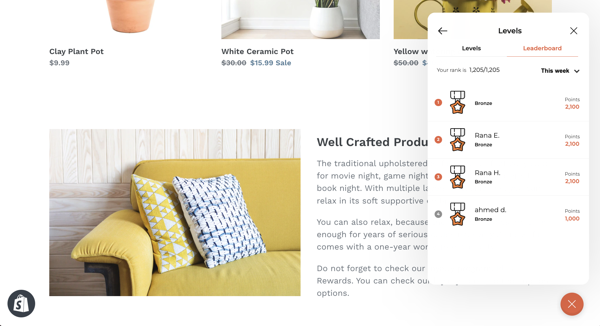
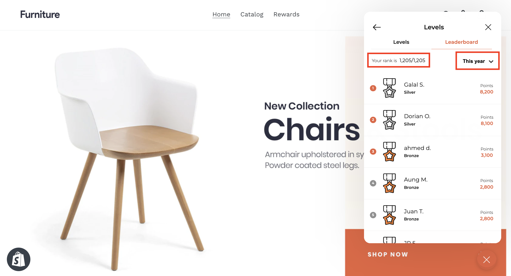

## Plan Availability

| **Platform** | **Plan** |
|--------------|----------|
| Shopify | Pro & Guru |
| Salla | Guru |
| Non-Platform | Enterprise (Add-on on Growth) |

{/* TODO: confirm plan availability. The release lists Shopify: Pro & Guru, Salla: Guru, Self-Serve: Enterprise (add-on on Growth). The previous table listed Pro as an add-on on Shopify and Salla. */}

Leaderboards can be a great tool to create a competitive environment and encourage your customers to be more active. However, leaderboards could also be demotivating if deployed within the wrong crowd. Gameball gives you the option to use it or to completely remove it when it is not convenient.

---

## How Does Gameball Leaderboard Work?

The leaderboard lets the customer track their progress and compare it to all your other customers.

The customer will be ranked based on their progress according to the [method of Tiering up](/product-documentation/programs/vip-tiers/tier-settings/tiering-up-methods) that you have configured in the Tier program. For example, if you chose "Amount Spent" to be the tiering up method, the customer will be ranked based on the amount they spent in comparison to other customers' spending.

To view the leaderboard, the customer needs to click on the **Progress bar** or the **Tier** found on the home section of the widget, then switch to the **Leaderboard tab**. The customer will then see their rank amongst other customers.

<Frame>
  
</Frame>

The leaderboard opens in under a second in your widget, down from around 16 seconds. Your existing leaderboard keeps every period, ranking depth, and API option it had before.

---

## How Are Customers Ranked?

The leaderboard ranks customers on net totals. When an order is refunded or cancelled, Gameball takes it off the customer's score in the period of the original purchase, so the leaderboard reflects what customers actually kept.

---

## How Can a Customer Know Their Exact Rank?

Customers can see their rank in comparison to the rest of the customers in the text above the customer list. Customers see their exact rank when they are in the top 100.

<Frame>
  
</Frame>

They can also filter the rank list according to:

- Today
- Yesterday
- This week
- Last week
- This month
- Last month
- This year
- All-time

---

## How Many Customers Does the Leaderboard Rank?

The leaderboard ranks up to 1,000 customers by default, and up to 10,000 when you need deeper rankings.

{/* TODO: confirm how to enable the 10,000-customer ranking depth (setting, plan, or contact support). */}

---

## How to Show or Hide the Gameball Leaderboard from the Widget

<Steps>
<Step title="Navigate to Visibility Settings">
  On the **Gameball Admin Dashboard**, go to **Widget > General: Visibility**.
</Step>

<Step title="Toggle Leaderboard Visibility">
  Under the **Leaderboard Tab**, check **Show** or **Hide** based on your objective.

  <Frame>
    
  </Frame>
</Step>

<Step title="Save and Refresh">
  Click **Save**, then refresh your website. You will find that the leaderboard tab has been completely removed (or restored).
</Step>
</Steps>

---

## Common Questions

<AccordionGroup>
  <Accordion title="What happens to a customer's rank when an order is refunded or cancelled?">
    The refund or cancellation comes off the customer's score in the period of the original purchase, not the period when the refund happened.
  </Accordion>
  <Accordion title="Can I get leaderboard rankings through the API?">
    Yes. The [Customer Leaderboard API](/api-reference/leaderboard/customer-leaderboard) returns rankings in milliseconds, with weekly, daily, and custom date ranges.
  </Accordion>
</AccordionGroup>

---

## Related Articles

<CardGroup cols={2}>
<Card title="Customize the Widget Launcher" icon="rocket" href="/product-documentation/customer-widget/start-configuring-profile/customize-your-loyalty-launcher-to-fit-your-platforms-interface">
  Control the shape, position, icon, and visibility of your loyalty launcher button.
</Card>

<Card title="Customize Tabs Visibility and Order" icon="eye" href="/product-documentation/customer-widget/start-configuring-profile/customizing-tabs-visibility-and-order-in-gameball-widget-settings">
  Control which tabs appear in your widget and in what order they are displayed.
</Card>
</CardGroup>
