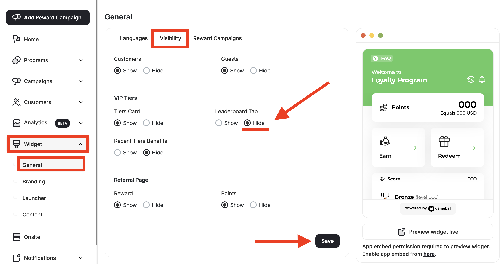

## Plan Availability

The **Normal** leaderboard is included with every plan that has the widget leaderboard. The **Advanced** leaderboard needs the **Advanced leaderboard** plan feature.

| **Platform** | **Plan (Normal leaderboard)** |
|--------------|----------|
| Shopify | Pro & Guru |
| Salla | Guru |
| Non-Platform | Enterprise (Add-on on Growth) |

{/* TODO: confirm plan availability for the Advanced tier. The release says it needs the Advanced leaderboard plan feature, on the plan or as an add-on, but does not list which plans include it. The previous table listed Pro as an add-on on Shopify and Salla; the Normal table now follows the release. */}

Leaderboards can be a great tool to create a competitive environment and encourage your customers to be more active. However, leaderboards could also be demotivating if deployed within the wrong crowd. Gameball gives you the option to use it or to completely remove it when it is not convenient.

---

## How Does Gameball Leaderboard Work?

The leaderboard lets the customer track their progress and compare it to all your other customers.

The customer is ranked based on the [levels method](/product-documentation/programs/vip-tiers/tier-settings/tiering-up-methods) that you have configured in the Tier program: amount spent, points, orders, referrals, or score. For example, if you chose "Amount Spent" as the method, the customer is ranked on the amount they spent in comparison to other customers' spending. Customers with the same result always appear in the same order.

To view the leaderboard, the customer needs to click on the **Progress bar** or the **Tier** found on the home section of the widget, then switch to the **Leaderboard tab**. The customer will then see their rank amongst other customers. The widget list shows the top 20 customers.

<Frame>
  
</Frame>

The leaderboard runs on a new engine, so it opens in under a second in your widget, down from around 16 seconds.

---

## How Are Customers Ranked?

The leaderboard ranks customers on net totals:

- When an order is refunded or cancelled, Gameball takes it off the customer's score in the period of the original purchase, so the leaderboard reflects what customers actually kept.
- Transactions blocked as fraud never count.

---

## What Are the Normal and Advanced Leaderboards?

The leaderboard comes in two tiers. **Normal** is included with every plan that has the widget leaderboard. **Advanced** adds more periods, deeper rankings, and the Leaderboard API.

<Note>
**Advanced Needs a Plan Feature**: The Advanced tier is unlocked only by the **Advanced leaderboard** plan feature, on your plan or as an add-on, and only with an active subscription. Without it, you stay on Normal. Every merchant using the leaderboard before this release moved to Advanced, so nobody lost anything.
</Note>

|  | **Normal** | **Advanced** |
|---|---|---|
| **Needs** | The **Widget leaderboard** plan feature (on every plan that has the widget leaderboard) | The **Advanced leaderboard** plan feature, on the plan or as an add-on, plus an active subscription |
| **Periods** | All-time, This month, Last month | Normal's periods, plus This week, Last week, Today, Yesterday |
| **Customers ranked** | Top 100 | 1,000 by default, up to 10,000 |
| **Widget list** | Top 20 | Top 20 |
| **Customer's own rank** | Exact inside the top 100, otherwise "100+" | Exact for every customer |
| **Leaderboard API** | Not included | Up to 50 rows per request, custom date ranges starting within the last 62 days, and filters |

{/* TODO: confirm how to enable the 10,000-customer ranking depth on Advanced (setting, plan, or contact support). */}

---

## How Can a Customer Know Their Exact Rank?

Customers can see their rank in comparison to the rest of the customers in the text above the customer list.

- **Advanced:** every customer sees their exact rank.
- **Normal:** customers see their exact rank inside the top 100, and "100+" otherwise.

<Frame>
  
</Frame>

---

## Which Periods Can Customers Filter By?

Customers can filter the rank list by period.

| **Period** | **Normal** | **Advanced** |
|---|---|---|
| All-time | Yes | Yes |
| This month | Yes | Yes |
| Last month | Yes | Yes |
| This week | No | Yes |
| Last week | No | Yes |
| Today | No | Yes |
| Yesterday | No | Yes |

{/* TODO: the previous version of this page also listed "This year". The release does not mention it for either tier. Confirm whether it still exists. */}

---

## How to Show or Hide the Gameball Leaderboard from the Widget

<Steps>
<Step title="Navigate to Visibility Settings">
  On the **Gameball Admin Dashboard**, go to **Widget > General: Visibility**.
</Step>

<Step title="Toggle Leaderboard Visibility">
  Under the **Leaderboard Tab**, check **Show** or **Hide** based on your objective.

  <Frame>
    
  </Frame>
</Step>

<Step title="Save and Refresh">
  Click **Save**, then refresh your website. You will find that the leaderboard tab has been completely removed (or restored).
</Step>
</Steps>

---

## Common Questions

<AccordionGroup>
  <Accordion title="What happens to a customer's rank when an order is refunded or cancelled?">
    The refund or cancellation comes off the customer's score in the period of the original purchase, not the period when the refund happened.
  </Accordion>
  <Accordion title="Why don't I see the weekly and daily leaderboards?">
    Weekly and daily periods are part of the Advanced leaderboard. It is unlocked only by the **Advanced leaderboard** plan feature, on your plan or as an add-on, and only with an active subscription. Without it, you stay on the Normal leaderboard.
  </Accordion>
  <Accordion title="Can I get leaderboard rankings through the API?">
    Yes, on the Advanced leaderboard. The [Customer Leaderboard API](/api-reference/leaderboard/customer-leaderboard) returns up to 50 rows per request, with custom date ranges and filters.
  </Accordion>
</AccordionGroup>

---

## Related Articles

<CardGroup cols={2}>
<Card title="Customize the Widget Launcher" icon="rocket" href="/product-documentation/customer-widget/start-configuring-profile/customize-your-loyalty-launcher-to-fit-your-platforms-interface">
  Control the shape, position, icon, and visibility of your loyalty launcher button.
</Card>

<Card title="Customize Tabs Visibility and Order" icon="eye" href="/product-documentation/customer-widget/start-configuring-profile/customizing-tabs-visibility-and-order-in-gameball-widget-settings">
  Control which tabs appear in your widget and in what order they are displayed.
</Card>
</CardGroup>
