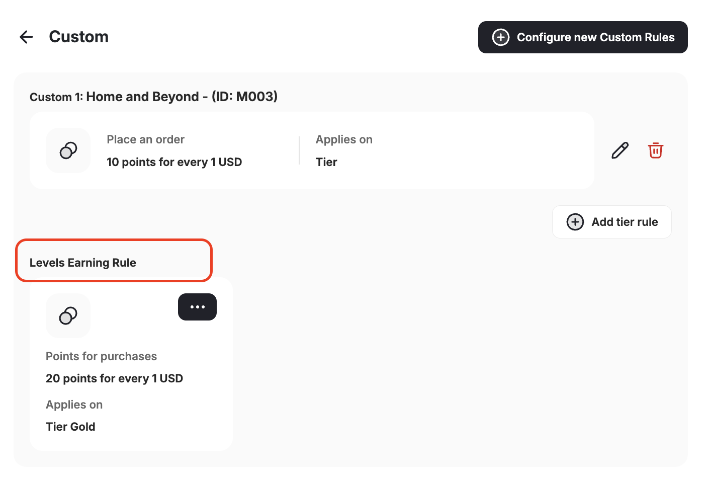
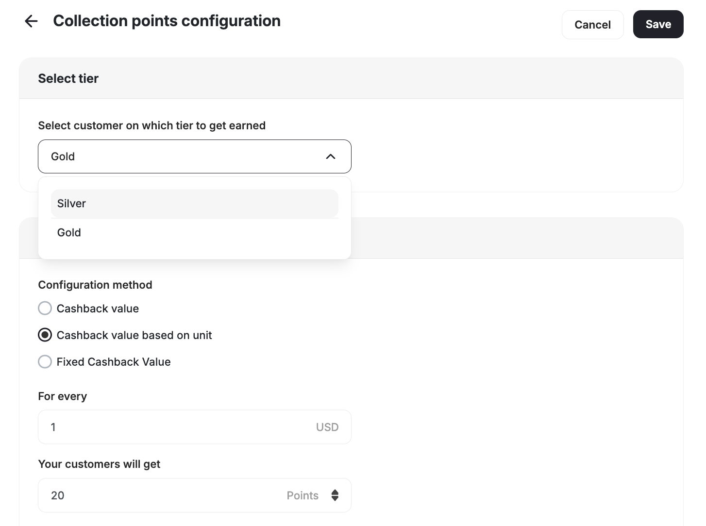

| Platform | Plan |
|----------|------|
| Shopify | Guru |
| Salla | Guru |
| Non-Platform | Enterprise |

Gameball lets you create custom point-earning rules based on any order attribute. Rather than applying a single flat earning rate across all purchases, you can define specific conditions — such as order value, payment method, or product category — and assign different point rewards to each scenario.

Custom earning rules are now called **special rates**. Your existing custom rules are listed under **Special Rates** on the **Points for Orders** page and keep earning as before.

---

## How to Set Up a Special Rate

<Steps>
<Step title="Navigate to Points for Orders">
  Go to **Programs > Earn Points** in your Gameball dashboard. The **Points for Orders** page opens.
</Step>

<Step title="Add a Special Rate">
  In the **Special Rates** card, click **Add Special Rate**.
</Step>

<Step title="Orders and Products">
  Click **Add Condition** and choose the attribute you want to match, such as:

  - Order total price
  - Product collection or category
  - SKU
  - Payment method
  - Custom order metadata

  When **SKU** is selected as the condition field, an **Upload CSV** option appears alongside the text input. Upload a CSV file to populate multiple SKUs at once instead of typing them individually. SKUs are automatically added to the field after upload and remain editable.

  <Frame>
    
  </Frame>

  <Note>
  CSV uploads support up to 100 SKUs per file. Clear validation messages are shown for any file type, size, or format issues.
  </Note>

  Each condition shows whether the **whole order** earns the rate (order conditions) or **only matching products** earn it (product conditions). See the [Condition Attributes Reference](#condition-attributes-reference) section below for more attributes.
</Step>

<Step title="Who and How Much">
  Set how many points matching products earn:

  - **Points per [currency]:** a number of points for every unit of currency spent. For example, 2 points for every 1 EGP spent on orders paid by credit card.
  - **% back:** a percentage of the amount back as points. For example, 5% back on a specific collection. This option shows only when you've set a point value in Redemption.

  **Everyone** earns the rate you set. Click **Add a Tier** to give a tier its own rate, for example a higher rate for Gold customers.

  <Note>
  **Fixed Cashback Value** (a set number of points per product, whatever its price) can't be chosen for new rates. Existing fixed rates keep earning.
  </Note>
</Step>

<Step title="Review and Save">
  Enter a **Rate name**, check the summary, then click **Save**. Matching products earn the special rate instead of the base and tier rates. Past orders don't change.
</Step>
</Steps>

[See the full Special Rates walkthrough](/product-documentation/programs/loyalty-points-earn/launch-and-configure-your-earn-pointing-system#special-rates)

---

## Combining Multiple Conditions

You can add several conditions to one special rate. Once you have two or more, choose whether products earn the rate when they match **all** or **any** of them.

**Examples:**

- Reward 10 points for orders where `total_price` **greater than** `50`
- Give 5 points per \$1 for `product_category` **equals** `Electronics`, versus 2 points per \$1 for `product_category` **equals** `Accessories`
- Award bonus points for high-value purchases from the Summer Collection paid by credit card

---

## Condition Attributes Reference

Beyond standard attributes like order total, payment method, and product category, the condition picker supports additional order-level and line-item-level attributes. These let you build more precise special rates — including tier-specific ones. With **Add a Tier**, each rate can give a specific **customer tier** its own value, so Gold customers earn at a different rate than Silver customers for the exact same order condition. For example, a Gold tier customer who places an order with 5 or more items could earn 3× points, while a Silver tier customer earns 2× on the same order.

### Order-Level Attributes

These attributes apply to the order as a whole. Combine them with a customer tier and a point assignment method to reward customers differently based on both their loyalty status and how they shop.

| Attribute | Description |
|---|---|
| **Redeemed amount in points** | The number of points the customer burned on this order |
| **Coupon codes** | The coupon code applied to the order |
| **Total items** | Total quantity of all line items in the order |
| **Total unique items** | Number of distinct products in the order |
| **has_points_redemption** | True if points were redeemed on this order |
| **has_coupon_redemption** | True if a coupon was burned on this order |

For example, you can set separate rules for each tier — giving Gold customers a 3× multiplier when their order contains 5 or more items, Silver customers a 2× multiplier for the same condition, and standard customers the default rate. You can also award a bonus earn rate to customers on any tier who purchase without applying a coupon code.

<Frame>
  
</Frame>

### Line-Item-Level Attributes

These attributes apply to individual products within the order. Use them when you want to adjust earning based on what happened to a specific item — for example, awarding a higher earn rate on full-price items or giving bonus points on taxed line items.

| Attribute | Description |
|---|---|
| **Discount** | The discount amount applied to the specific line item |
| **Tax** | The tax amount on the line item |

<Frame>
  
</Frame>

---

## How Special Rates Interact with Other Earn Rules

When multiple earning rules could apply to the same order, Gameball evaluates them based on rule priority. Products in a special rate earn that rate instead of the base rate and the tier rate. Only your **Exceptions** stop a special rate.

---

## Related Articles

<CardGroup cols={2}>
  <Card title="Launch and Configure Your Earn Pointing System" icon="rocket" href="/product-documentation/programs/loyalty-points-earn/launch-and-configure-your-earn-pointing-system">
    Set up your base earn rule and pointing system configuration.
  </Card>
  <Card title="Collection-Based Earning Rules" icon="layer-group" href="/product-documentation/programs/loyalty-points-earn/collection-based-earning-rules">
    Customize earning rates by product collection.
  </Card>
  <Card title="Understanding Loyalty Points Calculations" icon="calculator" href="/product-documentation/programs/loyalty-points-earn/understanding-loyalty-points-calculations-and-rules">
    Learn how Gameball prioritizes and calculates points across different rules.
  </Card>
</CardGroup>
