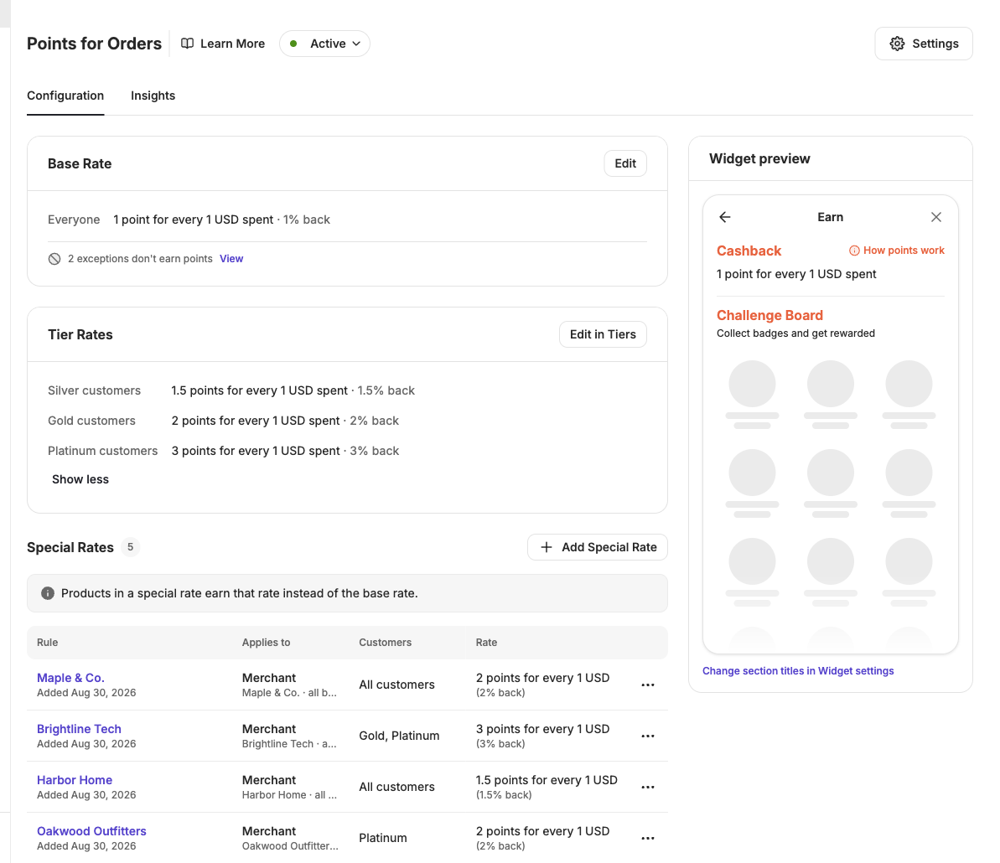
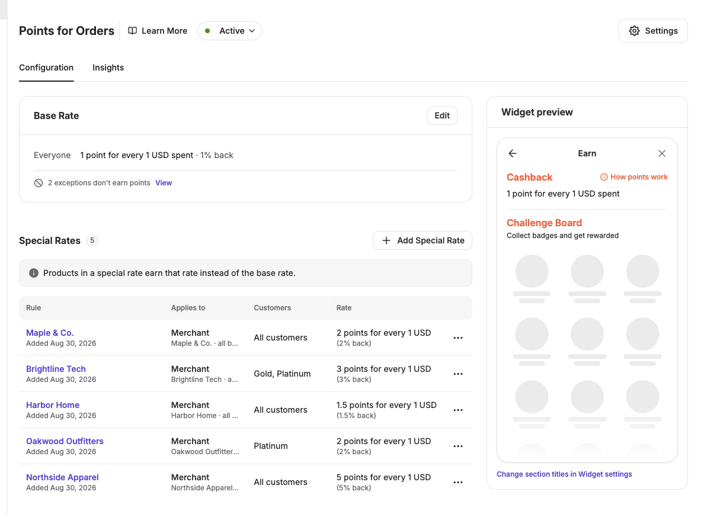
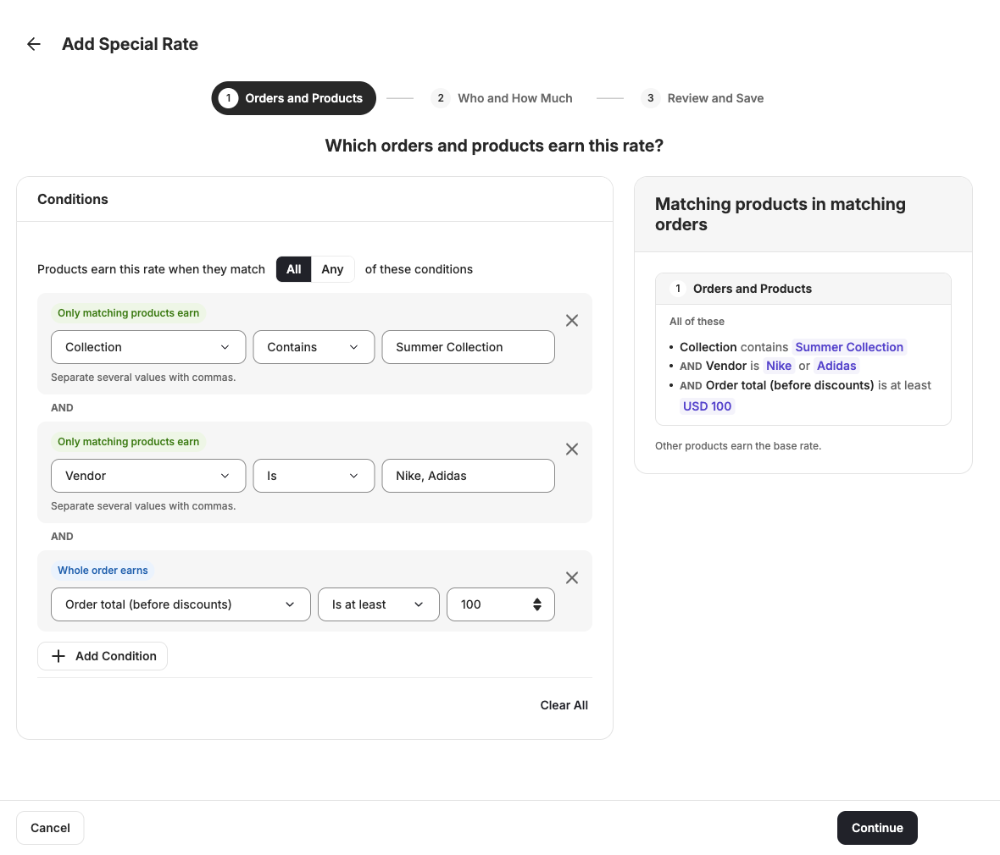
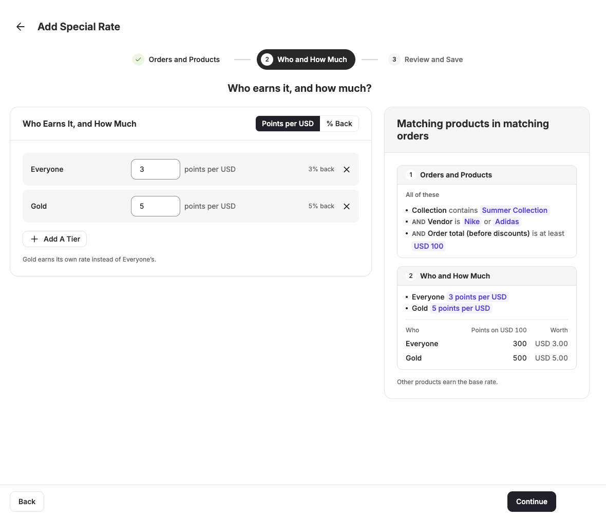
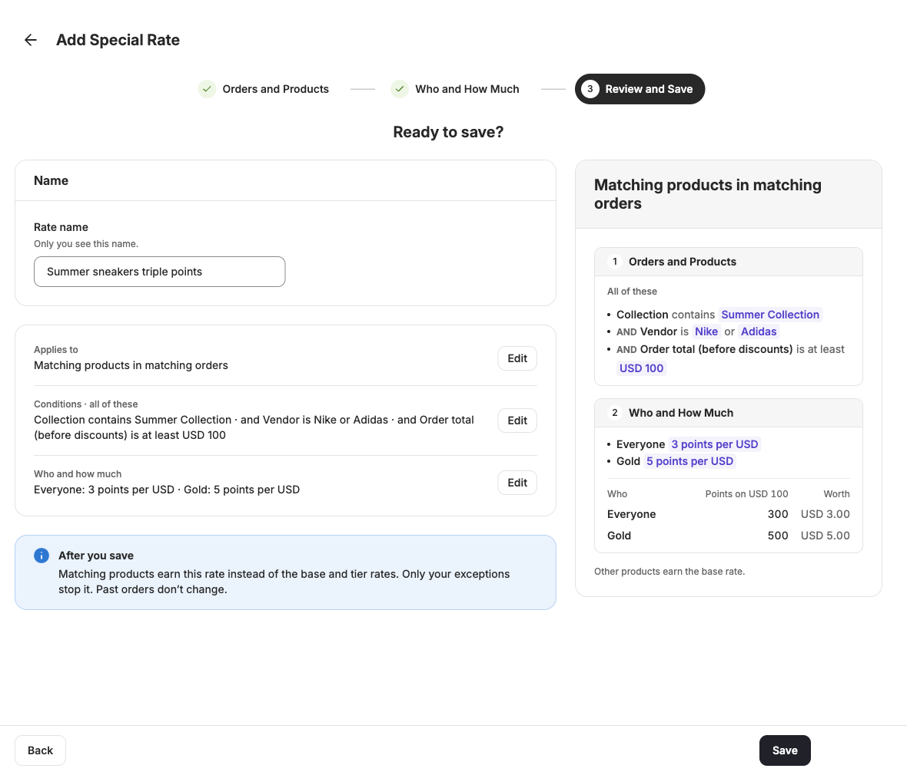
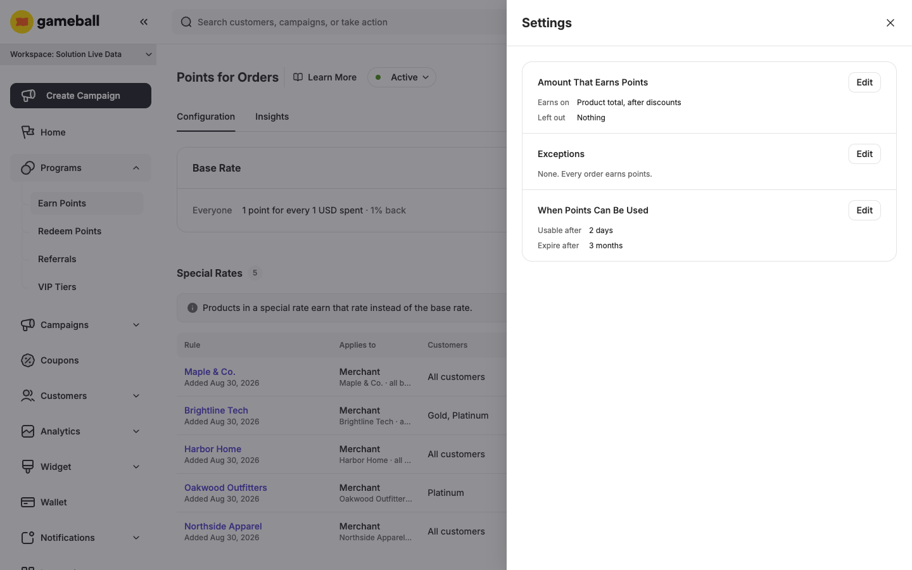
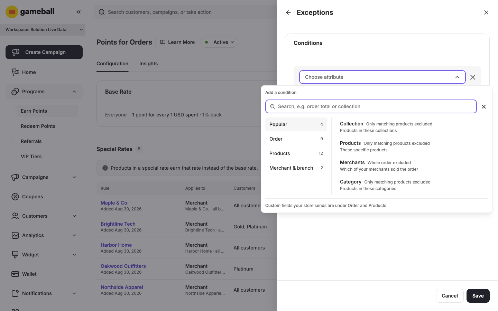
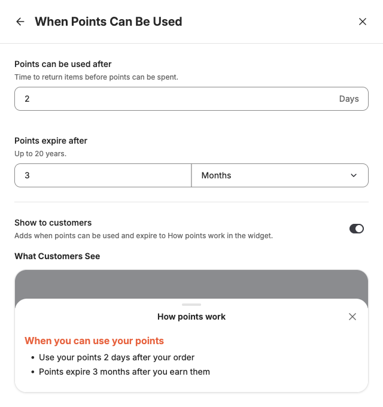
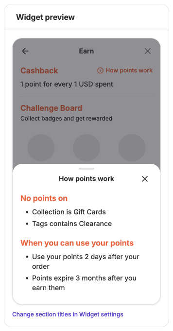

| Platform | Plan |
|---|---|
| Shopify | Free, Starter, Pro & Guru |
| Salla | Starter, Pro & Guru |
| Non-platform Clients | Growth & Enterprise |

Rewarding your customers with points is a powerful strategy to foster loyalty and encourage repeat purchases. With **Gameball's Earn Pointing System**, you can activate and fully customize how customers earn points based on their spending behavior.

---

## Step-by-Step Instructions

<Steps>
<Step title="Navigate to Points for Orders">
From the left-side menu, go to **Programs** and click **Earn Points**. The **Points for Orders** page opens on the **Configuration** tab.

Set the status at the top of the page to **Active** to start rewarding orders.
</Step>

<Step title="Set the Base Rate">
In the **Base Rate** card, click **Edit**. In **Edit Base Rate**, enter the points **Everyone** earns for every amount they spend (for example, 1 point for every 1 USD spent). The % back updates as you type, and an **Example** shows what an order earns. Click **Save**.

The card shows the rate and the equivalent cashback percentage, such as "1% back". The % back shows only when you've set a point value in Redemption.

<Info>
If you use **score** as your tiering-up method, set the score customers earn per amount spent in each tier's earning settings, in **Tiers**. [Learn more about Score](/product-documentation/programs/vip-tiers/tier-settings/tiering-up-methods).
</Info>
</Step>

<Step title="Review Your Rates on One Page">
The **Configuration** tab shows every rate that decides what an order earns:

- **Base Rate:** what everyone earns, with a line showing how many exceptions don't earn points. Click **View** to see them.
- **Tier Rates:** the rate for each VIP tier that has its own earning rate. Click **Edit in Tiers** to change them from your tier settings.
- **Special Rates:** rates for chosen products, collections or merchants. Products in a special rate earn that rate instead of the base rate.

<Frame>

</Frame>

The **Tier Rates** card shows only when at least one tier has its own earning rate. If all your tiers earn the base rate, or you don't use tiers, the card doesn't show.

<Frame>

</Frame>
</Step>
</Steps>

---

## Widget Preview

The **Widget preview** on the right of the page shows the widget's **Earn** screen as customers see it, with your current rate. Click **Change section titles in Widget settings** to rename the sections customers see.

---

## Special Rates

A **special rate** gives matching products, or whole matching orders, a different rate. Products in a special rate earn that rate instead of the base rate and the tier rate. Click **Add Special Rate** to create one in three steps.

Your custom earning rules, collection rules and merchant rates (formerly Merchant Rules) are all listed as special rates.

<Note>
Special rates depend on your plan:

- If your plan doesn't include special rates, you see an upgrade card instead of the list.
- If your plan includes merchant and branch rates only, **Add Special Rate** creates a merchant rate.
- Rates your plan doesn't cover stay in the list and keep earning, but you can only view or delete them.
</Note>

<Steps>
<Step title="Orders and Products">
Choose which orders and products earn this rate. Click **Add Condition** to pick a condition. You need at least one. Once you have two or more, choose whether products earn the rate when they match **all** or **any** of your conditions.

Each condition shows what it applies to:

- **Only matching products earn:** conditions on products, such as **Collection** or **Vendor**. Only the products that match earn the special rate.
- **Whole order earns:** conditions on the order, such as **Order total (before discounts)**. Every product in a matching order earns the special rate.

Separate several values with commas. The summary on the right lists your conditions, and other products earn the base rate.

<Frame>

</Frame>
</Step>

<Step title="Who and How Much">
Set the rate in **Points per USD** (your currency) or **% back**. The **% back** option shows only when you've set a point value in Redemption. **Everyone** earns the rate you set. Click **Add a Tier** to give a chosen tier its own rate instead of Everyone's. To give the rate only to the tiers you list, remove **Everyone**.

The summary on the right shows what an example order earns for each group, in points and in currency.

<Frame>

</Frame>
</Step>

<Step title="Review and Save">
Enter a **Rate name**. Only you see this name. Check what the rate applies to, its conditions and its rates, click **Edit** next to any of them to change it, then click **Save**.

<Frame>

</Frame>
</Step>
</Steps>

<Note>
After you save, matching products earn the special rate instead of the base and tier rates. Only your exceptions stop it. Past orders don't change.
</Note>

---

## Settings

Click **Settings** at the top right of the page to open the settings for how points are earned and used. Click **Edit** on any section to change it.

<Frame>

</Frame>

<AccordionGroup>
<Accordion title="Amount That Earns Points" icon="receipt">
Points are earned on the product total, after discounts. Choose whether to **Leave out taxes** and **Leave out shipping and fees**. An example receipt shows what earns points. The options you see depend on your plan.
</Accordion>

<Accordion title="Exceptions" icon="ban">
Choose the orders or products that don't earn points. Add a condition from the picker, which groups conditions under **Popular**, **Order**, **Products** and **Merchant & branch**, or search for one. Each condition shows whether the **whole order** is excluded or **only matching products** are excluded. Custom fields your store sends are under **Order** and **Products**. With two or more conditions, choose whether no points are given when an order or product matches **all** or **any** of them.

Turn on **Show to customers** to add the exceptions, under **No points on**, to **How points work** in the widget.

If you used to let only selected collections or products earn points, your setup keeps earning as before. When you edit it, Gameball asks you to switch to exceptions.

<Frame>

</Frame>

Exceptions apply to every rate, including special rates. [Learn more about eligible orders](/product-documentation/programs/loyalty-points-earn/eligible-orders-for-earning)
</Accordion>

<Accordion title="When Points Can Be Used" icon="clock">
- **Points can be used after:** the time customers have to return items before they can spend the points, in days.
- **Points expire after:** how long points last, in days, months or years, up to 20 years.
- **Show to customers:** adds when points can be used and when they expire to **How points work** in the widget. It's off by default. The **What Customers See** preview shows the result.

<Frame>

</Frame>

Points expiry is calculated from the exact moment points are earned. For example, with a 3-day expiry, points earned at 2:00 PM on January 1st expire at exactly 2:00 PM on January 4th (72 hours later).

**How expiry is enforced:**

- Customers **cannot redeem** expired points from the moment the expiry time passes — even before the system has processed the expiry.
- Expiry status is updated by a background job that runs **multiple times per day**. The dashboard may briefly show points as still active until the next job run, but redemption is blocked from the exact expiry moment.

<Note>
If points can only be used after a set time, the expiry countdown starts only after points become usable, not from when they were earned.
</Note>
</Accordion>
</AccordionGroup>

---

## How Points Work for Customers

Customers can tap **How points work** on the widget's **Earn** screen to open a sheet that explains:

- **No points on:** the exceptions that don't earn points. Collections, products, merchants and branches show as "Some collections", "Some products" and so on, without their names.
- **When you can use your points:** how long after an order points become usable, and when they expire

Each section shows only when its own **Show to customers** switch is on in **Settings**: one under **Exceptions** and one under **When Points Can Be Used**. Both are off by default. The **How points work** link appears only when at least one is on.

<Frame>

</Frame>

---

## Cashback Return Window API

You can control when cashback points become active using the `returnWindow` attribute.

**Available in:**

- **Order API:** under `cashbackConfigurations`
- **Cashback API:** under `configurations`

**Key Details:**

- `returnWindow` accepts values from 0 to 7300 days.
- Points remain pending for the set duration, then activate automatically.
- If not provided, the default duration from your Gameball settings applies.

---

## Insights and Analytics

Access in-depth analytics on how your Earn Points System is performing by clicking the **Insights** tab at the top of the page. Track total earned rewards, total rewarded points, and how reward trends evolve over time.

---

## Common Questions

<AccordionGroup>
<Accordion title="What happens if a customer returns a product after earning points?" icon="rotate-left">
Use **Points can be used after** in **Settings > When Points Can Be Used** to delay when points can be spent, helping avoid rewarding points for refunded purchases.
</Accordion>

<Accordion title="Can I create different earn rules for different products?" icon="layer-group">
Yes. Click **Add Special Rate** to give chosen products, collections or merchants their own rate, or add **Exceptions** in **Settings** for products that don't earn points.
</Accordion>

<Accordion title="Can I have an order-level return window?" icon="receipt">
Yes, you can set a return window at the order level.

To do this, include the `returnWindow` attribute inside the `cashbackConfigurations` object when creating the order using the **Order API**. This allows you to specify a custom return window per order — for example, 7 days for Order A and 10 days for Order B.

If `returnWindow` is not set in the API request, the default duration from your Gameball settings will apply.
</Accordion>

<Accordion title="Did the new Points for Orders page change how points are calculated?" icon="calculator">
No. The page shows your rates in a new way, but how points are calculated hasn't changed. [Learn more about points calculations](/product-documentation/programs/loyalty-points-earn/understanding-loyalty-points-calculations-and-rules)
</Accordion>
</AccordionGroup>

---

## Related Articles

<CardGroup cols={2}>
<Card title="Custom Earning Rules" icon="sliders" href="/product-documentation/programs/loyalty-points-earn/custom-earning-rules">
  Set different point values for different order types and attributes.
</Card>

<Card title="Configure Your Redeem Pointing System" icon="coins" href="/product-documentation/programs/loyalty-points-redeem/launch-and-configure-your-redeem-pointing-system">
  Set up how customers can redeem their earned points.
</Card>
</CardGroup>
