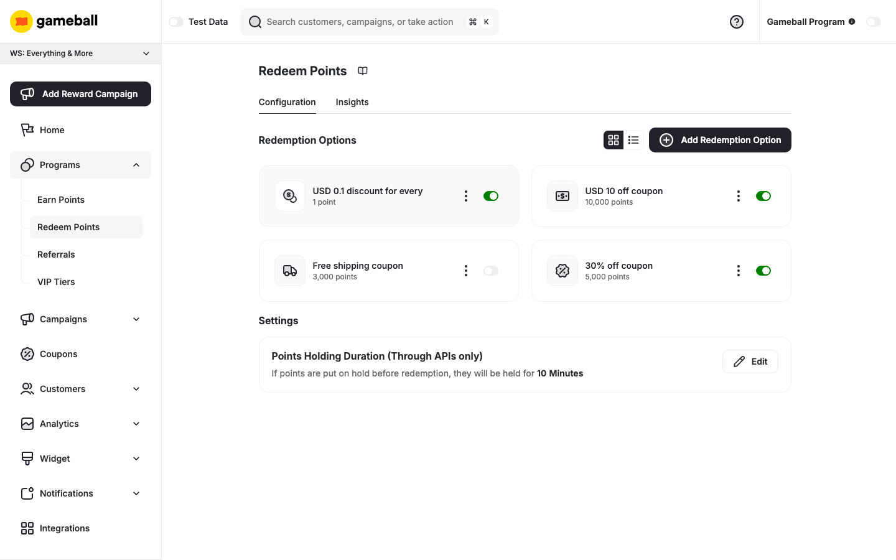
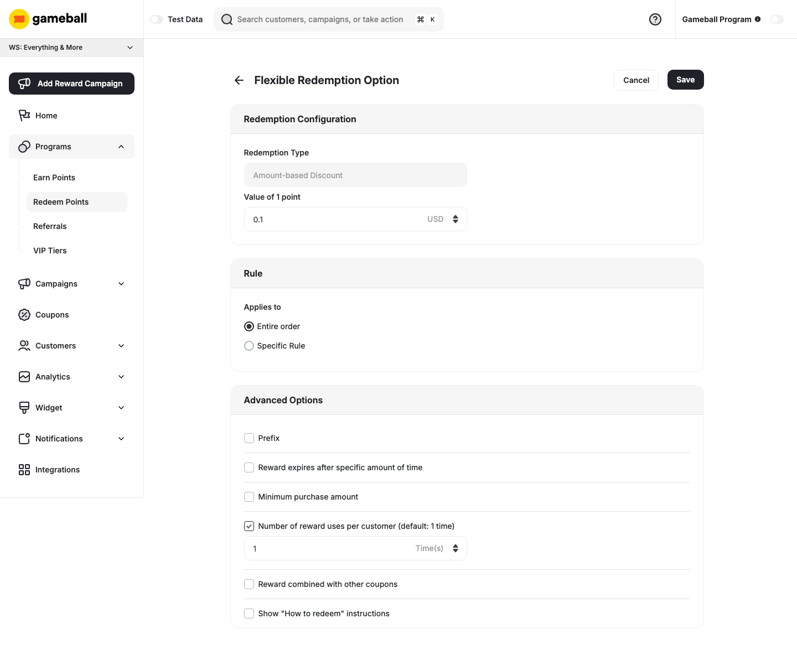
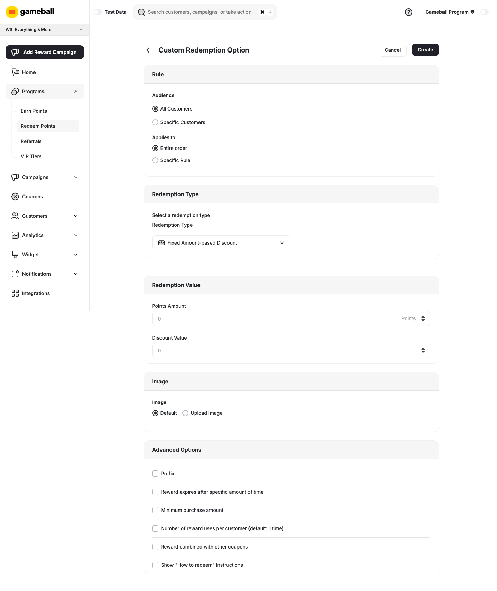
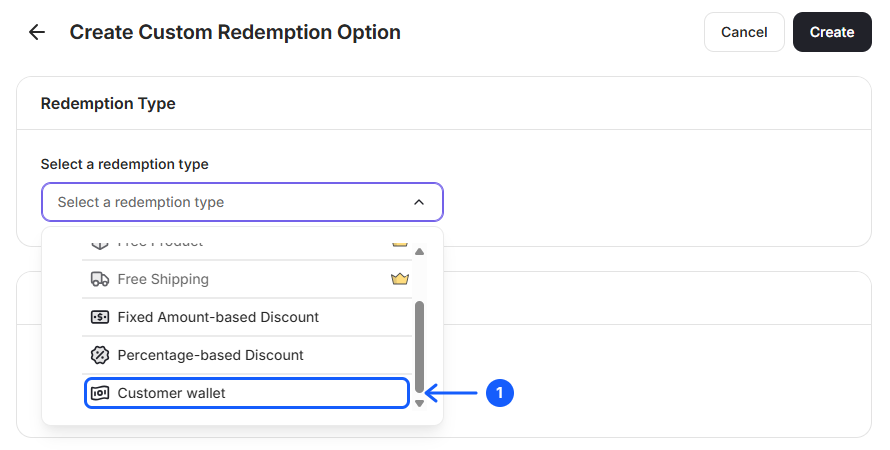
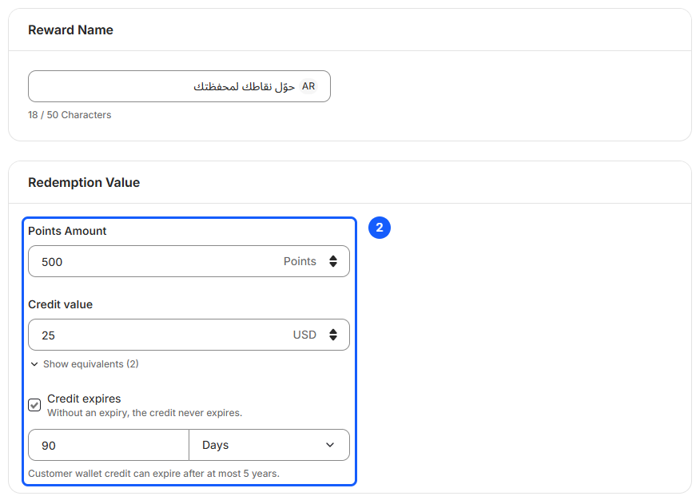
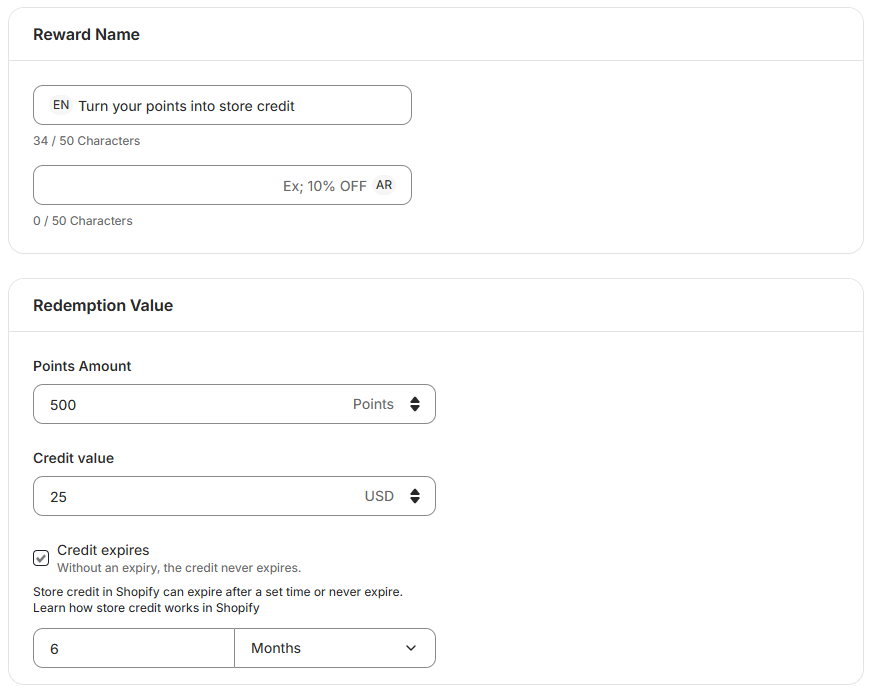
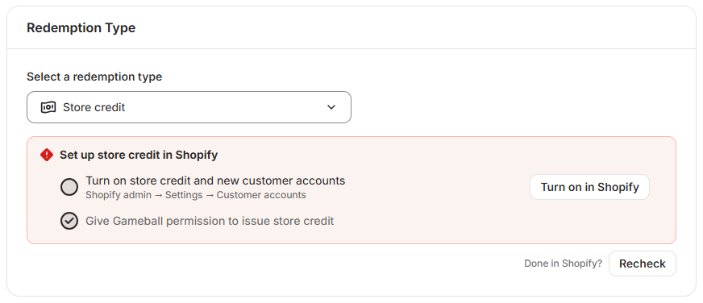
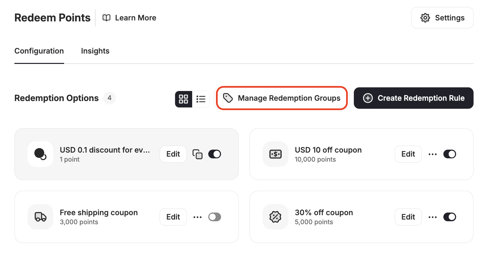
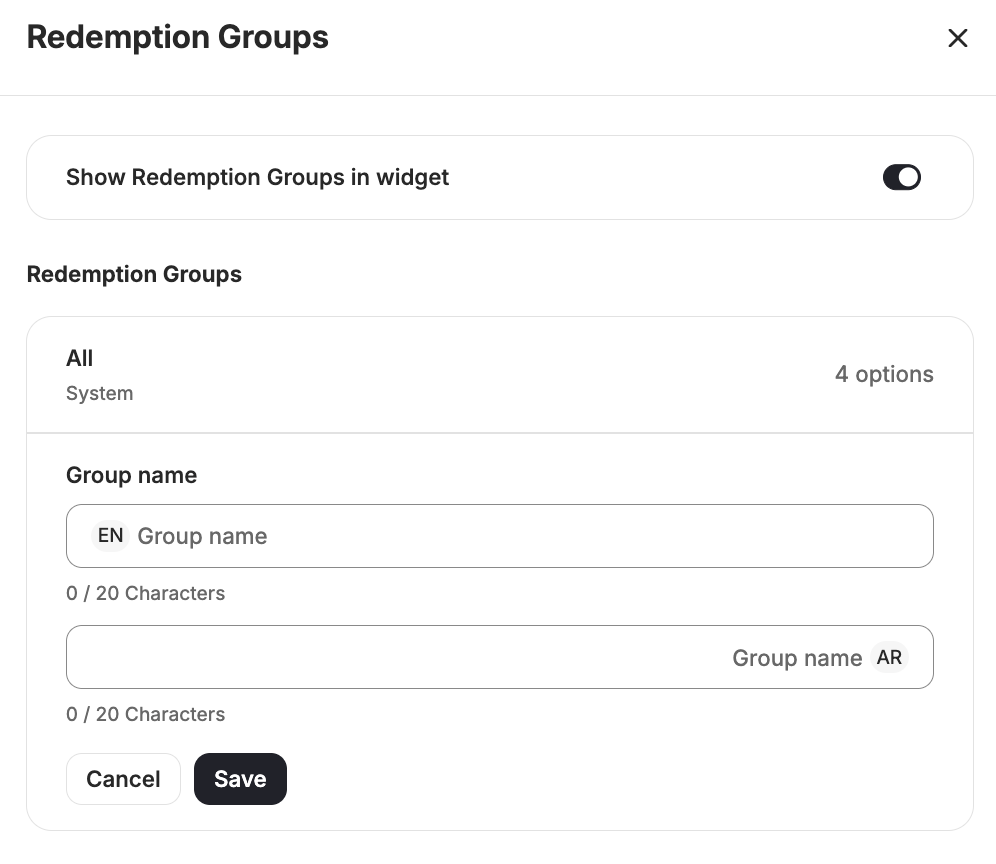

| Platform | Plan |
|---|---|
| Shopify | All Plans |
| Salla | All Plans |
| Non-platform Clients | All Plans |

Offering customers multiple ways to redeem their points is crucial for enhancing gamification and their loyalty to your brand. With Gameball's versatile redemption system, you can create a seamless and rewarding experience for your customers. By setting up various redemption options, you empower your customers to choose how they want to utilize their points.

---

## Navigating to Redeem Points

From the left-side menu, go to **Programs** and click **Redeem Points**. The page opens on the **Configuration** tab, where all your redemption options are listed.

<Frame>
  
</Frame>

---

## Default Redemption Rule

The **Redemption Options** section always includes a default dynamic rule displayed as **"USD X discount for every Y point"**. This rule defines the base conversion rate between points and currency — how much monetary value a single point is worth when customers redeem.

To edit it, click the **⋮** menu on the default rule card and select **Edit**. This opens the **Flexible Redemption Option** page where you can configure:

<Frame>
  
</Frame>

**Redemption Configuration**
- **Redemption Type** — locked as Amount-based Discount (cannot be changed)
- **Value of 1 point** — the monetary equivalent of a single point (e.g., 0.1 USD)

**Rule**
- **Applies to** — Entire order or Specific Rule

**Advanced Options** (optional) — same options as custom redemption options (prefix, expiry, minimum purchase amount, etc.)

Click **Save** to apply your changes.

<Info>
The cashback percentage shown on the earn rule edit panel is calculated based on this value. Changing the **Value of 1 point** here will update that percentage automatically.
</Info>

---

## Managing Redemption Options

All configured redemption options appear in the **Redemption Options** section. You can toggle between a **card view** and a **list view** using the icons at the top right of the section.

Each option displays its redemption type, the points required to redeem it, and a toggle to enable or disable it directly.

### Adding a New Redemption Option

<Steps>
<Step title="Click Add Redemption Option">
On the **Redeem Points** page, click **Add Redemption Option**.
</Step>

<Step title="Configure the Option">
You will be taken to the **Custom Redemption Option** page.

<Frame>
  
</Frame>

Fill in the following:

**Rule**
- **Audience** — choose whether this option applies to All Customers or Specific Customers
- **Applies to** — select Entire order or Specific Rule

**Redemption Type**
- Select a redemption type from the dropdown (e.g., Fixed Amount-based Discount, Percentage-based Discount, Free Shipping, Free Product)

**Reward Name**
- Enter the reward name in English (EN) and Arabic (AR) — up to 50 characters each

**Redemption Value**
- **Points Amount** — the number of points required to redeem this option
- **Discount Value** — the value of the discount awarded

**Image**
- Choose **Default** or **Upload Image** to set a custom icon for this redemption option

**Advanced Options** (optional)

| Option | Description |
|--------|-------------|
| **Prefix** | Add a custom prefix to the generated coupon code |
| **Reward expires after specific amount of time** | Set an expiry window for the issued coupon |
| **Minimum purchase amount** | Require a minimum order value for the coupon to apply |
| **Number of reward uses per customer** | Limit how many times a customer can redeem this option (default: 1 time) |
| **Reward combined with other coupons** | Allow this coupon to be stacked with other active coupons |
| **Show "How to redeem" instructions** | Display redemption instructions to customers |
</Step>

<Step title="Create">
Click **Create** to save the redemption option. It will appear in your Redemption Options list.
</Step>
</Steps>

Learn more about setting up each type:

- [Set Online Only Redemption Types](/product-documentation/rewards-campaigns/faqs/understanding-rewards-types)
- [Set POS Redemption Types](/product-documentation/guides-strategies-faqs/shopify-guides/spend-points-on-pos)

---

## Redeeming Points for Wallet Balance (Shopify & Salla)

Customers can turn their points into **wallet balance**: money added to their account in your store that they can spend at checkout. Wallet balance has fewer checkout restrictions than a coupon, adds directly to the customer's total balance, and one deposit can be spent across one or more orders. On Shopify this balance is called **store credit**, and on Salla it is called the **customer wallet**.

Use it to recover points before they expire: encourage customers whose points are about to expire to turn them into wallet balance, so they keep the value and come back to spend it.

### Adding a Wallet Balance Redemption Option

<Steps>
  <Step title="Pick the wallet balance redemption type">
    On the **Redeem Points** page, click **Add Redemption Option**. Under **Redemption Type**, select **Customer wallet** on Salla or **Store credit** on Shopify.

    <Frame>
    
    </Frame>
  </Step>
  <Step title="Set the points and wallet balance value">
    Enter the **Points Amount** and the **Credit value** the customer receives, for example 500 points = 25 USD. Select **Credit expires** to set an expiry, or leave it off so the balance never expires. Wallet balance can expire after at most 5 years.

    <Frame>
    
    </Frame>

    On Shopify, the same form is used for the store credit option.

    <Frame>
    
    </Frame>
  </Step>
  <Step title="Create the option">
    Enter the reward name in English and Arabic, then click **Create**. Customers see the option in the widget next to your other redemption options.
  </Step>
</Steps>

### What Customers See

Customers redeem from the widget, next to your other redemption options. The balance is added to their account right away, with no code to copy.

### Setup Check

If your store is not set up for wallet balance yet, the redemption and reward forms show what is missing and link you straight to the setting. After you finish in your store, click **Recheck**.

<Frame>

</Frame>

<Note>
On Salla, you can also give wallet balance as a reward for campaigns (including welcome and birthday), tier upgrades and referrals, with a custom expiry of up to 5 years. On Shopify, wallet balance is already available as a campaign reward. [Learn more](/product-documentation/rewards-campaigns/faqs/understanding-rewards-types)
</Note>

{/* TODO: confirm whether wallet balance redemption is available on all plans and whether Non-platform clients are excluded. */}

---

## Available Reward Types

<AccordionGroup>
<Accordion title="Online Only Rewards" icon="globe">

1. **Percentage-Based Discount:** Customers can exchange their points for a coupon that provides a percentage discount on their next purchase.
2. **Fixed Amount Discount:** Customers can redeem their points for a coupon that offers a fixed-value discount on their purchase.
3. **Free Shipping:** Customers can use their points to get free shipping on their order.
4. **Free Product:** Customers can redeem their points to receive specific products at no cost.
5. **Percentage-Based Cashback (Non-Platform Only):** Customers can use a coupon to receive a percentage of their purchase amount back as cashback, credited to their wallet in points or store credit.
6. **Fixed Amount Cashback (Non-Platform Only):** Customers can use a coupon to receive a fixed amount of cashback, credited to their wallet in points or store credit — regardless of the total purchase amount.
7. **Percentage-Based Fees Discount (Non-Platform Only):** Customers can receive a coupon that applies a percentage discount to transaction fees.
</Accordion>

<Accordion title="POS Rewards (Shopify Only)" icon="cash-register">

1. **POS Fixed Amount Coupon:** Redeem points for a specific amount off at point-of-sale.
2. **POS Percentage Coupon:** Redeem points for a percentage discount at point-of-sale.
</Accordion>
</AccordionGroup>

---

## Redemption Groups

Redemption Groups let you organise your redemption options into named categories — for example, "Coffee", "Merch", or "Experiences" — so customers can filter by group in the widget's Redeem tab instead of scrolling through every option.

### Setting Up Redemption Groups

<Steps>
  <Step title="Open Manage Redemption Groups">
    On the **Redeem Points** page, click **Manage Redemption Groups**.

    <Frame>
      
    </Frame>

    The **Redemption Groups** drawer opens.

    <Frame>
      
    </Frame>
  </Step>
  <Step title="Enable Groups in the Widget">
    Turn on **Show Redemption Groups in widget** to display group filter chips to customers.
  </Step>
  <Step title="Create a Group">
    Enter a group name in English and Arabic (up to 20 characters each), then click **Save**.
  </Step>
  <Step title="Assign Redemption Options">
    Open any redemption option and assign it to a group, or use the bulk banner that highlights options not yet assigned to a group.
  </Step>
</Steps>

<Note>
You can turn groups off at any time. Your group names and assignments are saved and restored when you turn them back on.

Merchants who have not set up any groups will see automatic chips by reward type in the widget instead: Fixed Amount, Percentage Discount, Free Shipping, and Free Product.
</Note>

---

## Settings

### Points Holding Duration

Set the duration that holds the redemption request until your customer completes the payment process — for example, when using points as partial payment alongside another payment method.

Click **Edit** next to **Points Holding Duration (Through APIs only)** to configure:

- **Holding Duration Value** — enter a number
- **Points Holding Time** — choose the unit: Minutes, Hours, or Days

---

## Insights and Analytics

Click the **Insights** tab at the top of the page to analyze the performance of each redemption option.

| Metric | Description |
|---|---|
| Issued | Number of coupons generated |
| Burned | Coupons redeemed or used |
| Expired | Coupons that expired unused |
| Burn Rate | % of issued coupons that were used |
| Expiry Rate | % of issued coupons that expired unused |
| Total Points | Total points redeemed to generate coupons |

<Tip>
- **Time Range Filter** allows analysis for specific date ranges (e.g., last 30 days).
- **Export Option** lets you download filtered insights in CSV/XLSX format.
- **Default Sorting** is by Total Points (descending), customizable across all columns.
</Tip>

---

## Related Articles

<CardGroup cols={2}>
<Card title="Launch and Configure Your Earn Pointing System" icon="rocket" href="/product-documentation/programs/loyalty-points-earn/launch-and-configure-your-earn-pointing-system">
  Configure how customers earn points for their purchases.
</Card>
</CardGroup>
