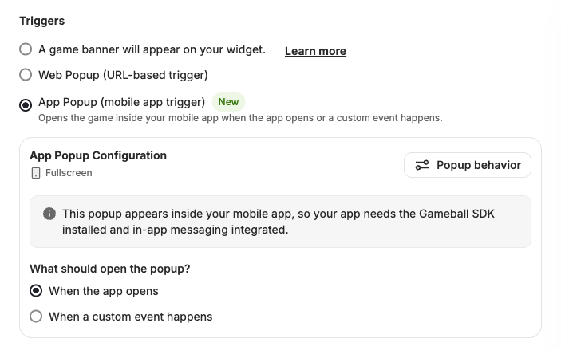
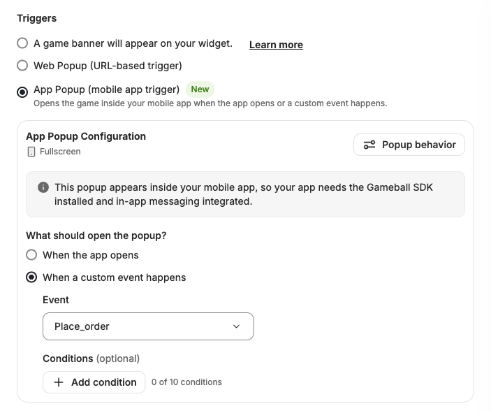
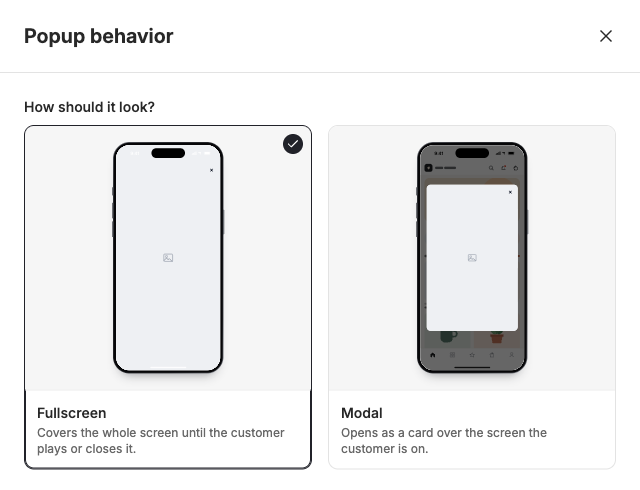

| Platform | Plan |
|---|---|
| Shopify | All Plans |
| Salla | All Plans |
| Non-platform Clients | All Plans |

**Gameball's App Popup** trigger opens a game campaign by itself inside your mobile app, so customers reach the game without opening the widget first. You set up the in-app integration once, then launch any game campaign as an App Popup from the dashboard, with almost no custom development per campaign.

---

## Which Campaigns Support App Popup

You can launch any of these 11 game campaigns as an App Popup:

- [Spin the Wheel](/product-documentation/rewards-campaigns/templates/engagement-gamification/spin-the-wheel)
- [Slot Machine](/product-documentation/rewards-campaigns/templates/engagement-gamification/slot-machine)
- [Scratch & Win](/product-documentation/rewards-campaigns/templates/engagement-gamification/scratch-and-win)
- [Match Cards](/product-documentation/rewards-campaigns/templates/engagement-gamification/match-cards)
- [Catcher](/product-documentation/rewards-campaigns/templates/engagement-gamification/the-catcher)
- [Quiz](/product-documentation/rewards-campaigns/templates/engagement-gamification/quiz)
- [Tic Tac Toe](/product-documentation/rewards-campaigns/templates/engagement-gamification/tic-tac-toe)
- [Space Shooter](/product-documentation/rewards-campaigns/templates/engagement-gamification/space-shooter)
- [Puzzle](/product-documentation/rewards-campaigns/templates/engagement-gamification/sliding-puzzle)
- [Tap the Target](/product-documentation/rewards-campaigns/templates/engagement-gamification/tap-the-target)
- [Driving Game](/product-documentation/rewards-campaigns/templates/engagement-gamification/driving-game)

<Note>
**Web Only Campaigns**: App Popup isn't available for campaigns whose platform visibility is set to Web only.
</Note>

---

## Set Up an App Popup

Your app needs the Gameball SDK installed and in-app messaging integrated before an App Popup can open. You do this once for all your campaigns.

<Steps>
  <Step title="Choose App Popup under Rules → Triggers">
    In the campaign builder, go to **Rules → Triggers** and select **App Popup (mobile app trigger)**. It sits next to the widget banner and **Web Popup (URL-based trigger)** options.

    <Frame>
    
    </Frame>
  </Step>
  <Step title="Choose what opens the popup">
    Under **What should open the popup?**, select one of the following:

    - **When the app opens**: The popup opens when the customer opens your app.
    - **When a custom event happens**: Select the **Event** that opens the popup. Optionally, click **Add condition** to narrow it down by the event's properties. You can add up to 10 conditions.

    <Frame>
    
    </Frame>
  </Step>
  <Step title="Choose Fullscreen or Modal in Popup behavior">
    Click **Popup behavior** and choose how the popup looks:

    - **Fullscreen**: Covers the whole screen until the customer plays or closes it.
    - **Modal**: Opens as a card over the screen the customer is on.

    <Frame>
    
    </Frame>
  </Step>
</Steps>

---

## Control How Often the Popup Appears

App Popup uses the same rules as in-app messages: the repeat setting, minimum interval, cooldown, and quiet hours. [Learn more about in-app message delivery settings](/product-documentation/communication-campaigns/create-and-configure-in-app-messaging-campaigns).

---

## Common Questions

<AccordionGroup>
  <Accordion title="Do I need custom development for every campaign?">
    No. After the in-app integration is set up once, you launch each game campaign as an App Popup from the dashboard, with almost no custom development per campaign.
  </Accordion>
  <Accordion title="Why can't I pick App Popup on my campaign?">
    App Popup isn't available for campaigns set to Web only. Change the campaign's platform visibility to include mobile, then select the trigger again.
  </Accordion>
</AccordionGroup>

---

## Related Articles

<CardGroup cols={2}>
  <Card title="Create and Configure In-App Messaging Campaigns" icon="mobile" href="/product-documentation/communication-campaigns/create-and-configure-in-app-messaging-campaigns">
    Learn how in-app message delivery rules work.
  </Card>
  <Card title="Trigger Game Popups Based on Page URL" icon="link" href="/product-documentation/rewards-campaigns/reward-campaign-url">
    Show game popups on your website with Web Popup.
  </Card>
</CardGroup>
