This guide walks you through the essential setup steps for any reward campaign on Gameball, including how to define your audience, choose triggers and rewards, control repeatability, and track success with goal-based performance metrics.

---

## Manage Your Campaign List

The **Reward Campaigns** list is split into tabs by status, so you can see what is running, what has finished, and what is still a draft without setting a filter.

| Tab | What it shows |
|---|---|
| **Live & Scheduled** | Campaigns that are running or scheduled to start |
| **Completed & Inactive** | Campaigns that have finished or are inactive |
| **Drafts** | Campaigns you have started but not launched |

<Frame>
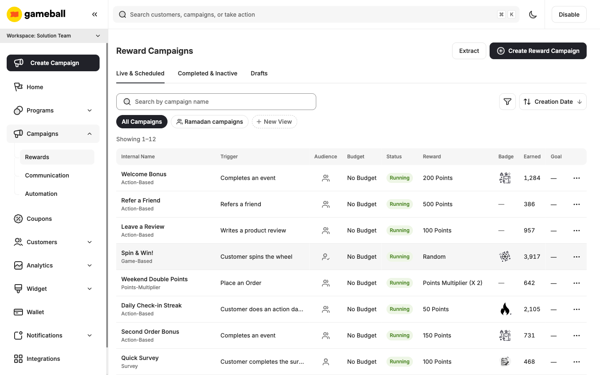
</Frame>

<Frame>
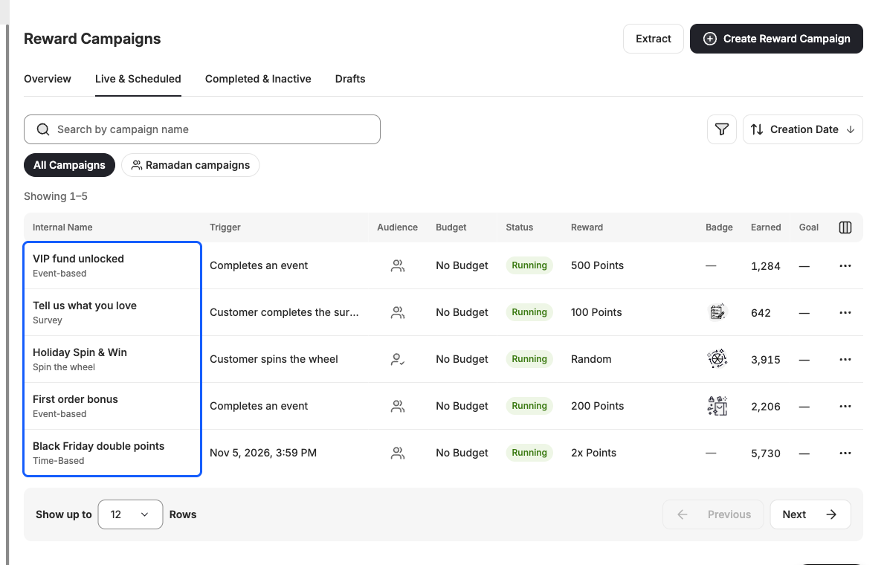
</Frame>

- Under each campaign's name, **Live & Scheduled** shows the campaign's own type, such as Stamps, Streak or Spin the wheel, matching the **Overview** tab. Types without a name of their own still show their group.
- Scheduled campaigns move to **Completed & Inactive** on their own once their date has passed, so the **Live & Scheduled** tab shows only what is running.
- Gameball keeps you on the same tab after a reload or after you open a campaign.
- Exporting includes only the campaigns in the tab you are viewing.
- Your saved view and filters stay applied when you switch tabs.
- Drag, add, and hide columns in the table header. [Learn more](/product-documentation/understanding-your-customers/your-customers/manage-your-customer-list#save-views-and-choose-your-columns)

<Note>
The [Communication](/product-documentation/communication-campaigns/introduction-to-communication-campaigns#manage-your-campaign-list) and [Automations](/product-documentation/automation-campaigns/how-to-create-an-automation-campaign#manage-your-automation-list) lists use the same three tabs.
</Note>

---

## See Your Campaigns on a Timeline

The **Overview** tab on **Reward Campaigns** puts your campaigns on a timeline, so you can see what is running, what is coming up, and what has gone quiet without opening each campaign.

<Frame>
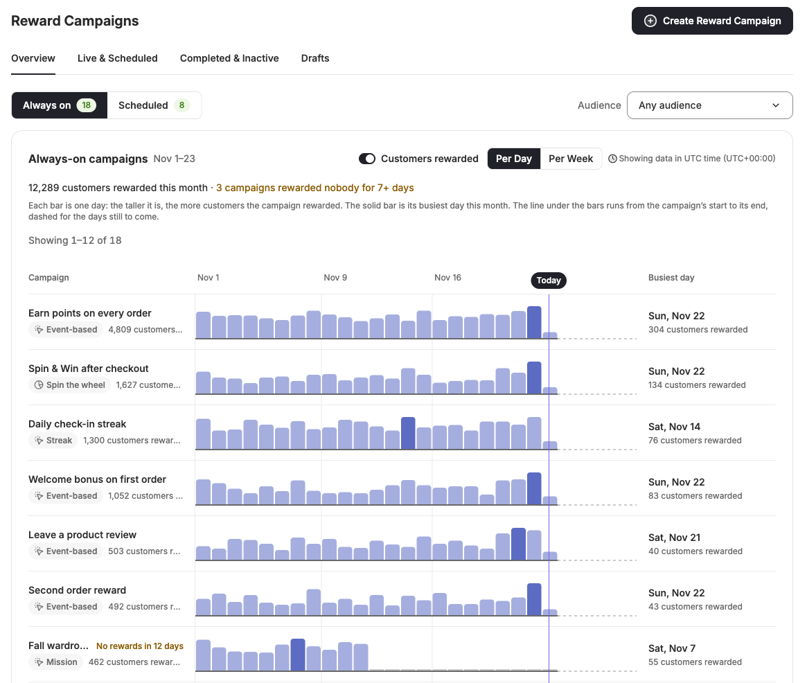
</Frame>

- Switch between **Always on** campaigns for this month and **Scheduled** campaigns on a monthly timeline. You can go up to 12 months back and 12 months ahead.
- Filter both views by audience.
- Turn on **Customers rewarded** to draw each campaign's rewarded customers per day or per week on its bar, with its busiest day named.
- Spot quiet campaigns with the "No rewards in N days" and "No rewards this month" flags.
- Click **Show more** to see every campaign in a busy month, 12, 24, or 48 rows at a time.

<Frame>
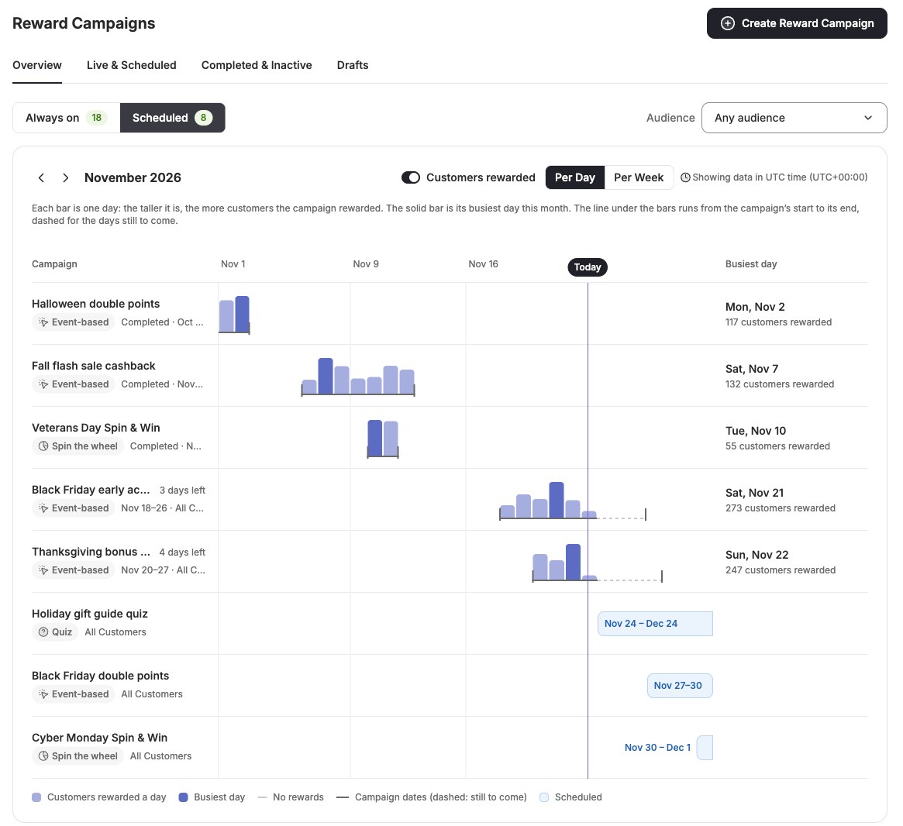
</Frame>

---

## Audience

This is where you decide who will see and interact with your campaign. Gameball gives you flexible options to target the right users.

<Frame>
  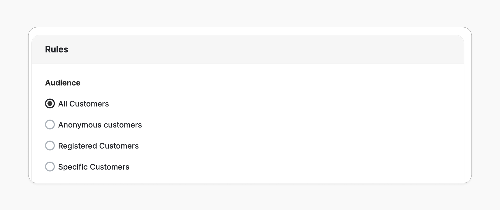
</Frame>

<AccordionGroup>
  <Accordion title="All Customers" icon="users">
    The campaign will be visible to everyone, whether they are signed in or not.
  </Accordion>

  <Accordion title="Registered Customers" icon="user-check">
    Only customers who are logged into their accounts will be able to see and engage with the campaign.

    <Note>This option is not available for all campaigns.</Note>
  </Accordion>

  <Accordion title="Anonymous Customers" icon="user-secret">
    Targets visitors who haven't signed up yet. Great for encouraging signups or collecting emails before they can join the campaign.

    - If you choose **Anonymous** as the audience, the campaign will be available to visitors who are not yet identified on your store.
    - Once enabled, a lead form will automatically appear prompting the customer to enter their information (e.g. name, email).
    - This is a great way to collect leads and retarget potential customers later.
    - You can fully customize this form by navigating to **Customize Design > Lead Form**.

    <Frame>
      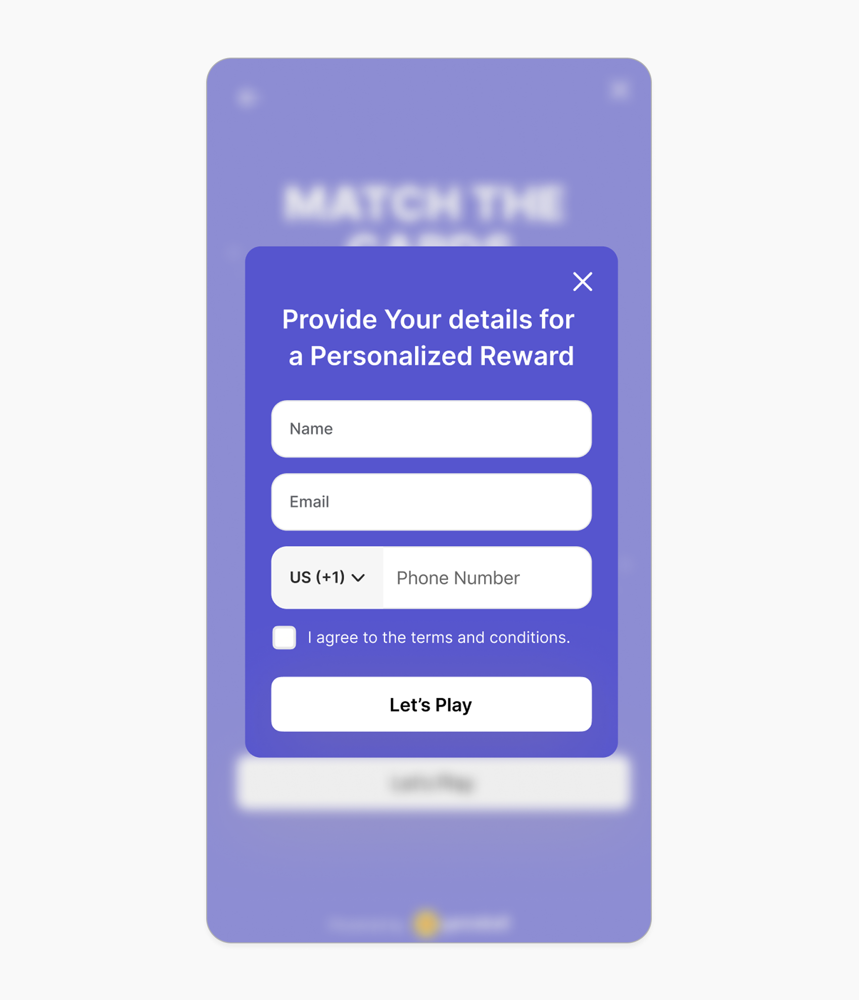
    </Frame>

    <Note>
    - Available for **Shopify** and **Non-platform** only.
    - This option is not available for all campaigns.
    </Note>
  </Accordion>

  <Accordion title="Specific Customers" icon="filter">
    Narrow down your audience using detailed filters:

    - **Segment**: Target predefined or custom audience segments from your dashboard. [Learn more](/product-documentation/customer-segmentation)
    - **RFM Segment**: Reach users based on their Recency, Frequency, and Monetary values. [Learn more](/product-documentation/customer-segmentation)
    - **Tag**: Include or exclude users based on specific tags assigned to them. [Learn more](/product-documentation/understanding-your-customers/gameball-customers)
    - **Customer Attribute**: Use custom fields like level, join date, total orders, etc.

    The **Choose attribute** list is sorted A–Z in your dashboard language, with your custom attributes mixed in with the built-in ones.

    <Frame>
    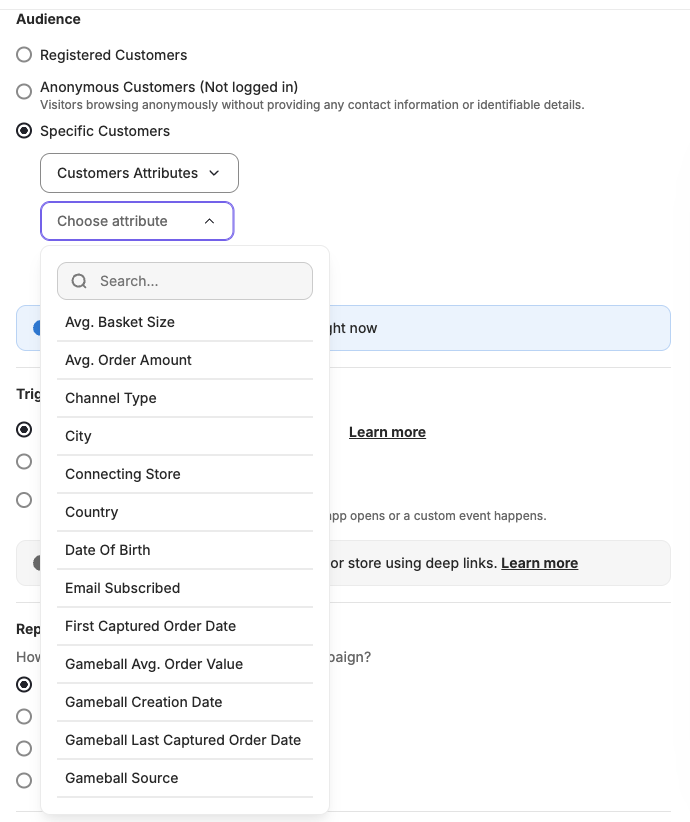
    </Frame>
  </Accordion>
</AccordionGroup>

---

## Trigger

Triggers vary between campaigns, some are based on actions like orders or referrals, others on social interactions such as likes or shares, and some are tied to special occasions like birthdays or anniversaries.

[Check the guide for trigger details per campaign](/product-documentation/rewards-campaigns/reward-campaign-intro)

---

## Repeatability

Set how many times a customer can receive the reward from your campaign.

<Tabs>
  <Tab title="Unlimited">
    Customers can receive the reward every time the trigger is fulfilled, with no limit.

    <Frame>
      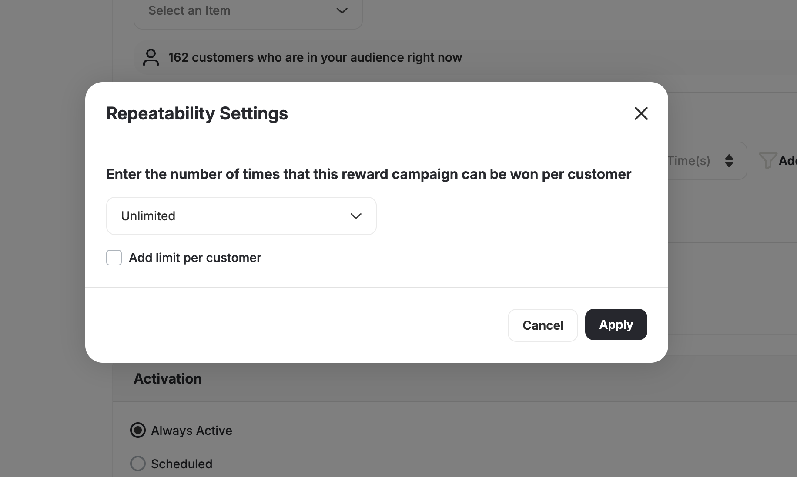
    </Frame>
  </Tab>
  <Tab title="Limited to X Times">
    Customers can receive the reward only a specific number of times (e.g., 1 time only), even if the trigger keeps happening.

    e.g., 10 times only

    <Frame>
      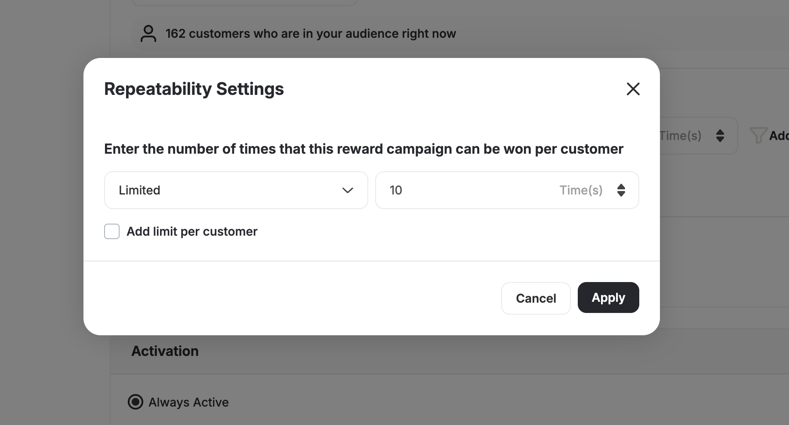
    </Frame>
  </Tab>
  <Tab title="Unlimited with Time-Based Limit">
    Customers can receive the reward every time the trigger is fulfilled, but only once (or a set number of times) per day.

    e.g., 1 time per day

    <Frame>
      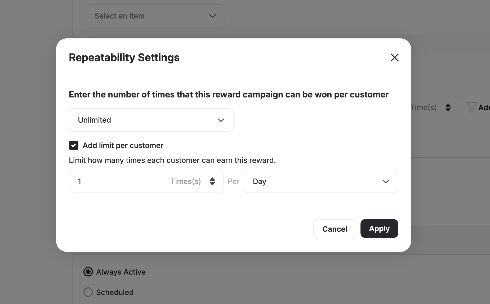
    </Frame>
  </Tab>
  <Tab title="Limited with Time-Based Limit">
    Customers can receive the reward a limited number of times overall, and also only once (or a set number of times) per day.

    e.g., 1 time per day, with a maximum of 10 times in total.

    <Frame>
      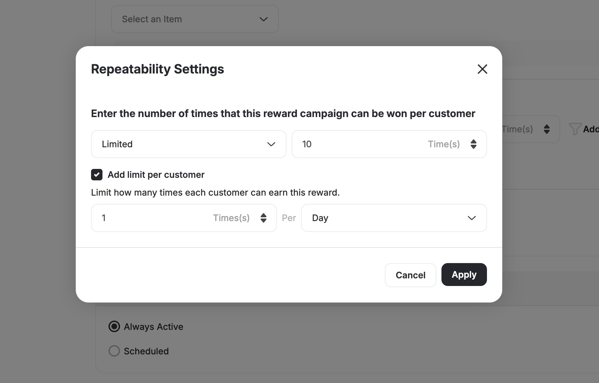
    </Frame>
  </Tab>
</Tabs>

### TikTok Campaigns

TikTok campaigns have the same repeat options as your other campaigns, such as up to 5 times overall or once a week. Each reward needs a new video posted after the campaign starts. When a customer's videos have already earned the reward, the widget asks them to post a new one.

<Frame>
  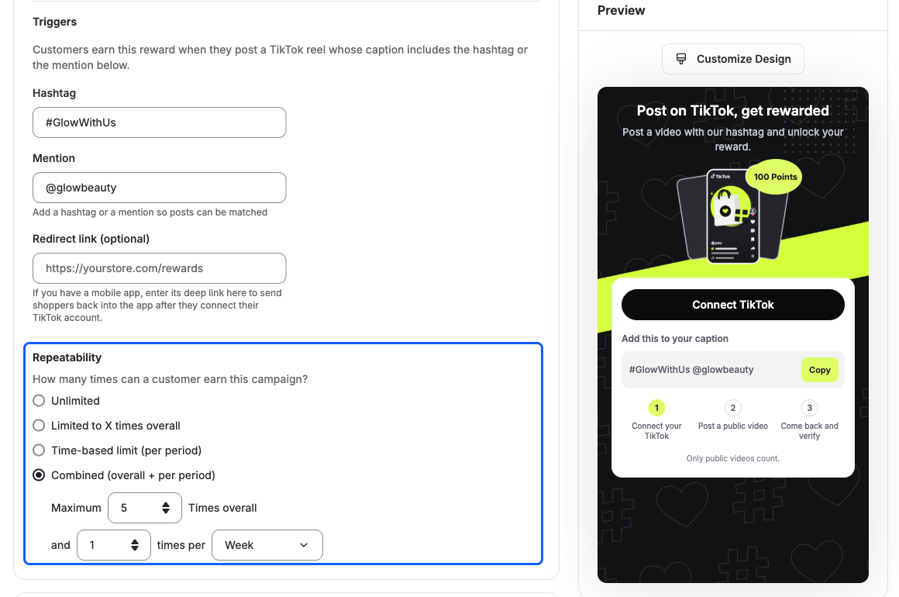
</Frame>

---

## Activation

Decide when the campaign will be active for your customers.

<Frame>
  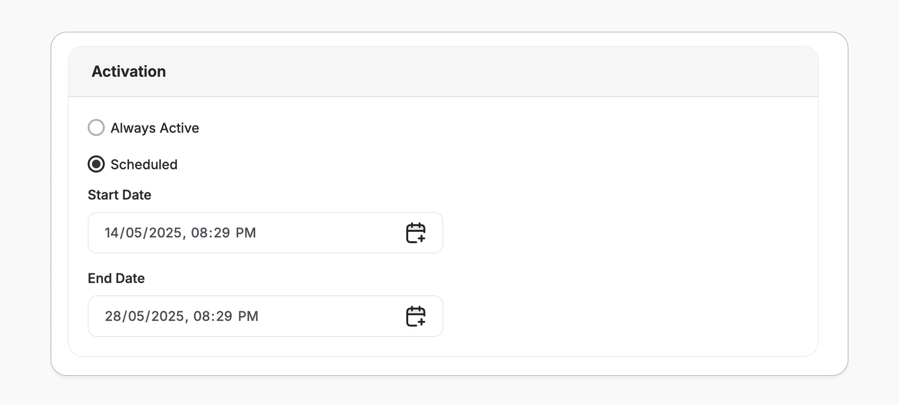
</Frame>

<Tabs>
  <Tab title="Always Active">
    The campaign will run continuously unless you manually deactivate it.
  </Tab>
  <Tab title="Scheduled">
    Set a start and end date for the campaign. It will only be visible and active during that time period.
  </Tab>
</Tabs>

---

## Details

Set up what your customers will see on Gameball's widget in your app or website.

<Frame>
  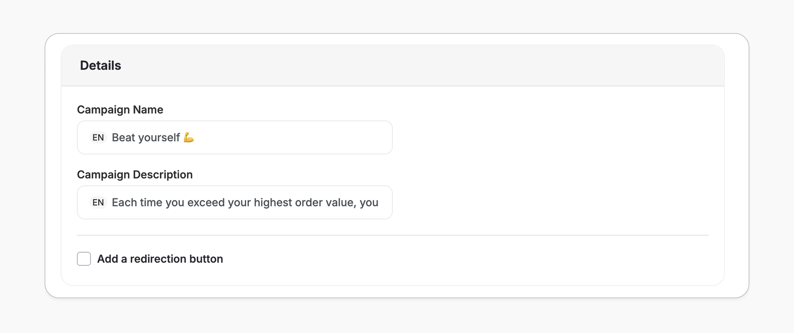
</Frame>

<Note>
Settings you make on a campaign's inner pages, such as each prize's winning chance, reward limit and daily supply cap, also show on the campaign's details page and on the edit-page card that opens each inner page.
</Note>

**Campaign Name**

The title of the campaign as it will appear to your customers.

**Campaign Description**

A short message explaining what the campaign is about.

**Redirection Link** [Optional]

1. **Redirection URL**: e.g., `https://example.com`
2. **Button Text**: Text that appears on the button.
3. **Query Parameters (optional)**: Add custom parameters to personalize or track the link (e.g., UTM-source)
4. This option is not available in all campaigns.

---

## Reward

Set the type of reward customers will receive when they complete the campaign.

Choose one of the following reward types: points, free product, free shipping, etc.

[Learn how to set up each reward type and advanced options.](/product-documentation/rewards-campaigns/faqs/understanding-rewards-types)

---

## Badge

**Icon**

Choose a badge icon for your campaign in one of three ways:

- **Gameball Library** — Select from a curated set of pre-made badge icons.
- **Upload** — Upload your own custom image.
- **AI Image Studio** — Generate a custom badge image by typing a text prompt directly in the dashboard. No design tools or external software needed. Generated images go through automatic post-processing — background removal, light/dark theme injection based on your widget mode, and edge-filling — so assets are production-ready without any manual cleanup.

  When clicking **Regenerate**, your last submitted prompt is pre-filled so you can refine it without retyping. Switching between **Generate with AI**, **From Library**, and **Upload** tabs does not clear your prompt. Style selection is locked while a generation is in progress.

  Images in the library are organized by their intended slot — backgrounds appear only in background pickers, pointer images only in pointer slots — so purpose-specific assets never show up in the wrong context.

<Frame>
  
</Frame>

**Visibility**

By default, no badge is selected, meaning the campaign won't appear on the widget. You can choose to:

- **Show dimmed badge until earned**: Badge appears faded, then becomes bright when achieved.
- **Show only when earned**: Badge is hidden until the customer earns it.

<Frame>
  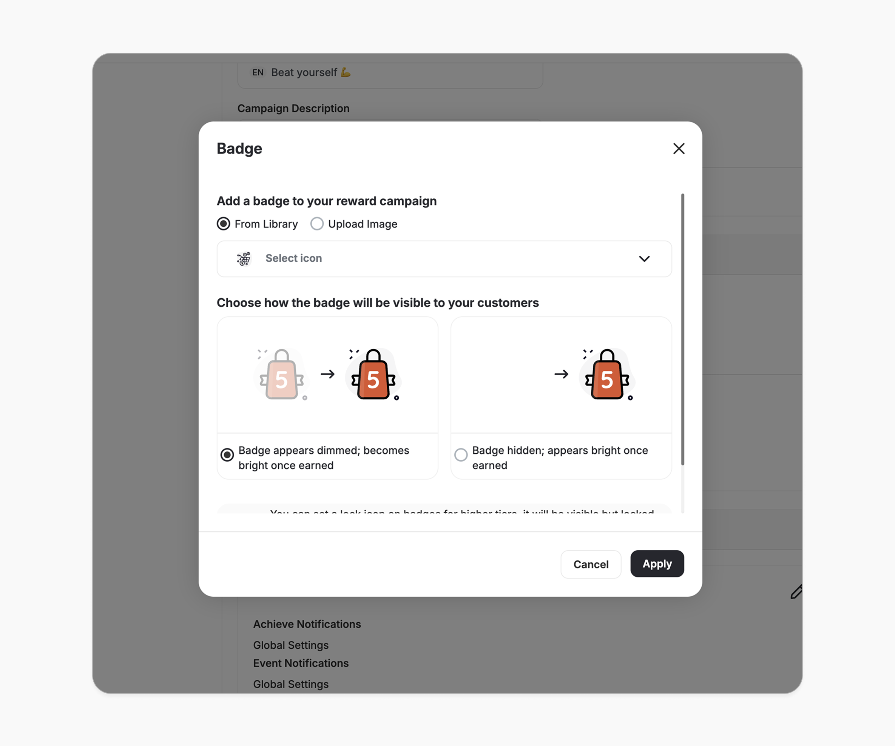
</Frame>

**Tier-locked**

- By default, the badge is hidden if you're not part of the selected audience, except when the audience is a specific tier. In that case, the badge will appear with a lock icon, indicating it will unlock once the user reaches that tier.
- To enable this, apply an audience filter based on the tier from the campaign's main configuration page.

<Frame>
  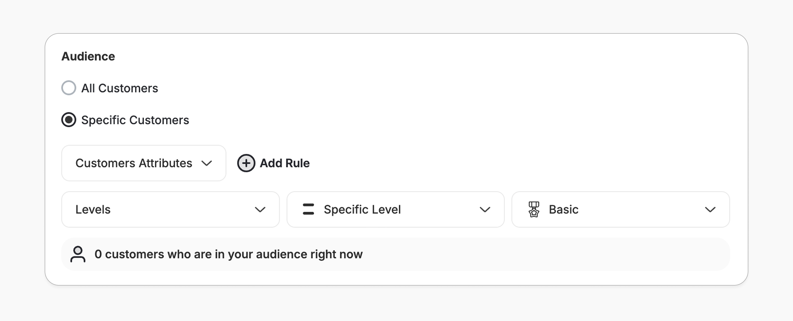
</Frame>

---

## Notification

Keep your customers engaged and informed by setting up notifications for their actions and achievements.

**Achievement Notification**

Choose whether to notify customers when they **successfully achieve** the campaign reward.

<Frame>
  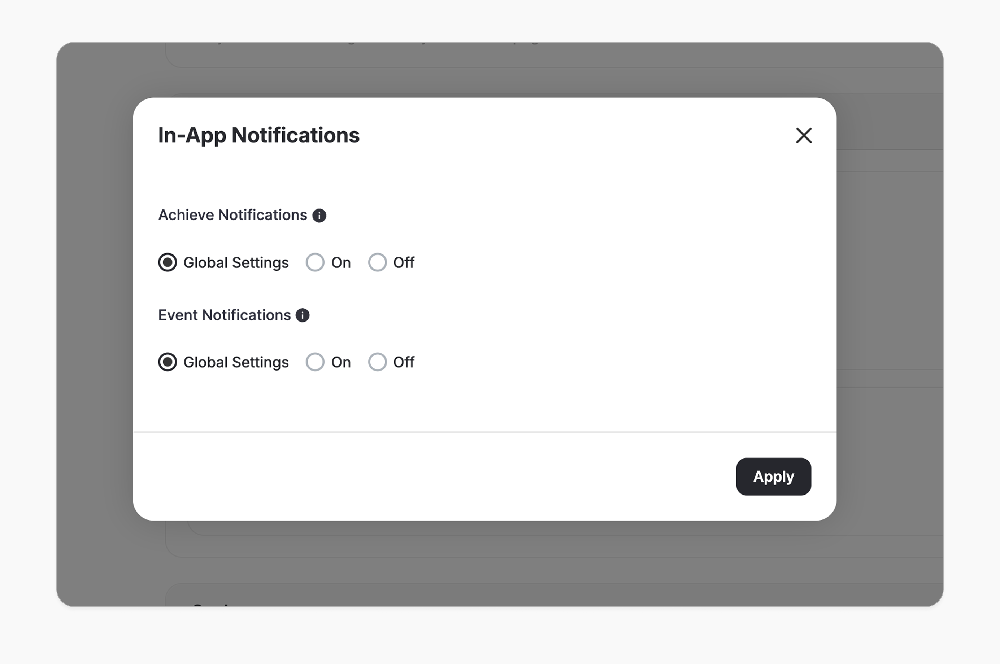
</Frame>

**Event Notification**

Notify customers when they complete an **action that brings them closer** to achieving the campaign.

<Tabs>
  <Tab title="Global Setting">
    Uses the default notification preferences you've already set in your Notifications settings.

    [Learn more about configuring global notifications](/product-documentation/rewards-campaigns/reward-campaign-general-setup-guide)
  </Tab>
  <Tab title="Always ON">
    This overrides global settings and **forces notifications ON**, even if they are disabled globally. Allows you to customize the notification content.
  </Tab>
  <Tab title="Always OFF">
    This overrides global settings and **forces notifications OFF**, even if they are enabled globally. Customers will not receive any notifications for this campaign.
  </Tab>
</Tabs>

---

## Goal

Measure the impact of your campaign by tracking a specific action you want your customers to complete.

<Frame>
  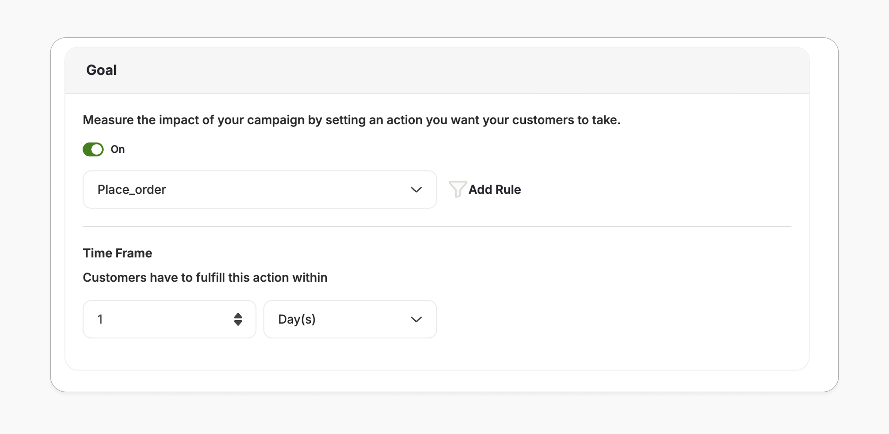
</Frame>

**Action**

Choose an event like `place_order`, and optionally add filters such as order value, location, or product category to refine it.

**Time Frame**

The goal time frame defines how long customers have to complete the action after the campaign starts (e.g., within 7 days). The count starts from when the campaign starts, not when it ends.

---

## Customization

### Design and Content

You can fully customize each stage of the campaign through dedicated tabs representing the different screens in the flow:

- **Banner (For game-based campaigns)**
- **Intro / Main Screen** (Spin the Wheel also has an optional **Intro** start page before the wheel)
- **Lead Form (if audience set to Anonymous Customers - Not logged in)**
- **Success Screen**
- **No Luck Screen**

For each screen, you can tailor the following elements:

- **Branding**: Adjust background colors, text colors, and upload custom artworks.
- **Content**: Edit the headlines, descriptions, and call-to-action messages to match your tone and messaging.

This allows you to create a fully branded, on-theme experience that aligns with your business identity.

<Frame>
  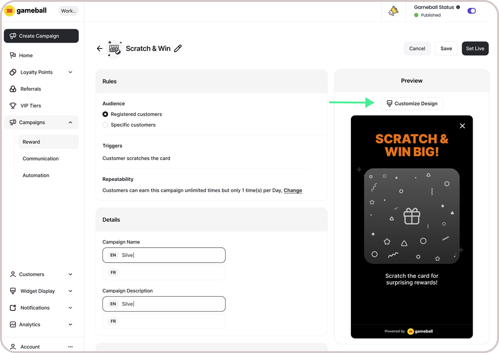
</Frame>

<Frame>
  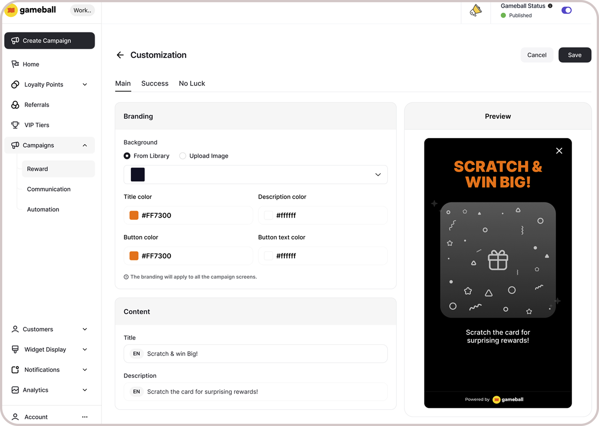
</Frame>

<Note>Customizing the lead form also allows you to add a hyperlink to the "terms and services" so that customers can read and accept them before clicking submit.</Note>

---

## Budget Control

Budget Control system allows you to define, monitor, and enforce spending limits for reward-based campaigns. This provides tighter cost governance, clearer visibility, and automated safeguards against overspending.

<Frame>
  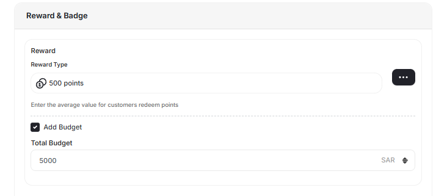
</Frame>

When creating a campaign, you can enable Budget Control to set a Total Budget, which is always defined in the workspace currency and cannot be changed afterward. Once activated, the system uses the entered amount as the campaign's full spending limit and automatically displays any additional configuration fields needed based on the reward type to ensure accurate cost calculation.

Budget Control requires a valid numerical value, and negative or non-numeric entries are not allowed. If Budget Control is turned on for a campaign that is already active or has been active before, tracking begins only from that moment, previous spending is not counted.

Turning the feature off resets the budget entirely, clears all accumulated metrics, and removes budget-related data from the campaign preview; re-enabling it starts fresh tracking with no historical records.

When editing an existing budget, the system prevents you from saving a value lower than the issued or actual spend and displays a warning if the current costs already exceed the proposed amount. Within the campaign overview, a dedicated Budget card shows the Total Budget, Issued Cost (liability), and Actual Spend (redeemed rewards), and tracking continues even if the campaign becomes inactive since previously issued rewards may still be redeemed.

You will also receive automated email alerts when spending reaches 50%, 80%, and 100% of the budget, and the campaign is automatically deactivated upon hitting 100% to prevent any further spending.

<AccordionGroup>
  <Accordion title="If a campaign budget is fully consumed, will the campaign automatically stop? Will its badge still appear in the widget?" icon="circle-question">
    Yes. Once a campaign reaches 100% of its budget, it is automatically deactivated. You will also receive email notifications when the budget reaches 50%, 80%, and 100%.

    As for the badge, its visibility depends on two things:

    1. Whether the customer has completed the campaign.
    2. The badge visibility setting you selected when configuring the campaign.

    If a customer has earned the campaign reward, the badge will still appear for them. If not, its visibility will follow the rules you set.

    **What does "badge visibility" mean?**

    When setting up a campaign, you can choose how (or if) the campaign's badge appears inside the widget. You have three options:

    **1. No Badge**

    The campaign will not appear anywhere in the widget, whether the customer earns it or not.

    **2. Always Visible**

    The badge will appear dimmed before the customer earns it. Once earned, it becomes highlighted and will remain visible permanently, even if the campaign is later deactivated.

    **3. Visible If Earned**

    The badge remains hidden until the customer earns the reward. After achievement, it appears highlighted and stays visible permanently, even if the campaign is deactivated.
  </Accordion>
</AccordionGroup>
