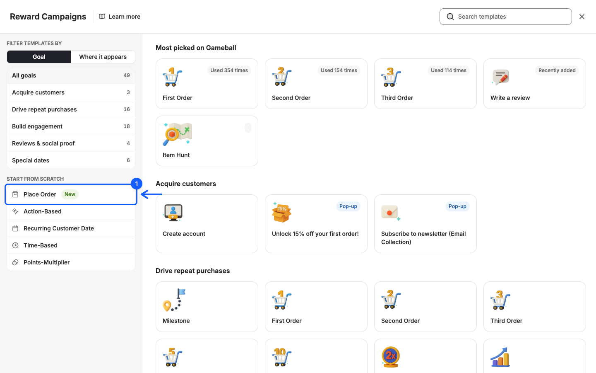
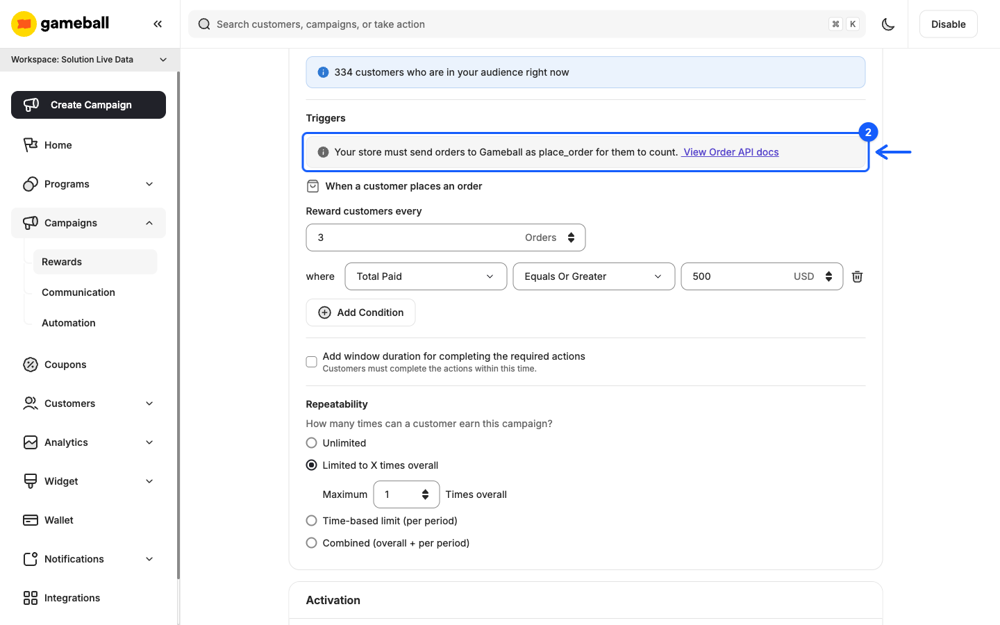
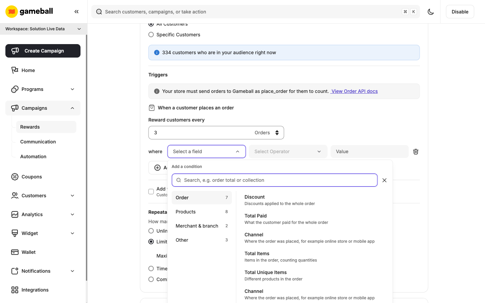

## Plan Availability

{/* TODO: confirm plans. The release did not state them; this table copies the other Start from Scratch campaign pages. */}

<Tabs>
<Tab title="Shopify & Salla">
| Plan | Available |
|---|---|
| Pro & Guru | Yes |
</Tab>

<Tab title="Non-Platform">
| Plan | Available |
|---|---|
| Growth | Yes |
| Enterprise | Yes |
</Tab>
</Tabs>

A **Place Order campaign** rewards your customers for placing orders. You choose how often customers get rewarded, for example every 3rd order, and add conditions so that only the orders you care about count, such as orders where the total paid is 500 or more.

---

## Create a Place Order Campaign

<Steps>
<Step title="Pick Place Order from Start from Scratch">
  Log in to your **Gameball Dashboard**, navigate to **Campaigns** on the left side menu and click **Rewards**. Click **Create Reward Campaign**, then choose **Place Order** under **Start from Scratch**.

  <Frame>
  
  </Frame>
</Step>

<Step title="Set how often customers get rewarded">
  Under **Triggers**, the trigger is already set to **When a customer places an order**. In **Reward customers every**, enter the number of orders a customer must place to earn the reward. For example, enter `3` to reward every 3rd order.

  A note above the trigger reminds you that only orders your store sends to Gameball as `place_order` count toward the campaign. Click **View Order API docs** in the note to see how to send them.

  {/* TODO: confirm whether "Reward customers every 3 Orders" rewards the 3rd, 6th, 9th order and so on, or only the 3rd order, and how it interacts with Repeatability. */}

  <Frame>
  
  </Frame>
</Step>

<Step title="Add conditions to the orders that count">
  Click **Add Condition** to open the condition picker, then choose a field, an operator and a value. For example, **Total Paid** **Equals Or Greater** `500` USD. Use the trash icon to remove a condition.

  Fields in the picker are grouped into **Order**, **Products**, **Merchant & branch**, and **Other**, and you can search them by name, for example "order total" or "collection". The **Order** group includes fields such as:

  - **Discount**: discounts applied to the whole order
  - **Total Paid**: what the customer paid for the whole order
  - **Channel**: where the order was placed, for example online store or mobile app
  - **Total Items**: items in the order, counting quantities
  - **Total Unique Items**: different products in the order

  {/* TODO: confirm the field names in the Products, Merchant & branch and Other groups (the screenshot only shows the Order group). */}
  {/* TODO: confirm how several conditions combine (all must match, or any). */}

  <Frame>
  
  </Frame>
</Step>

<Step title="Finish the rest of the setup">
  Complete the remaining sections the same way as any reward campaign:

  - **Audience**: All Customers or Specific Customers. Gameball shows how many customers are in your audience right now.
  - **Window duration** (optional): Select **Add window duration for completing the required actions** to give customers a time limit for placing the required orders.
  - **Repeatability**: **Unlimited**, **Limited to X times overall**, **Time-based limit (per period)**, or **Combined (overall + per period)**.
  - **Activation**: **Always Active** or **Scheduled**.
  - **Details**, **Rewards & Badges**, and **Notifications**.

  [Learn more about each section](/product-documentation/rewards-campaigns/reward-campaign-general-setup-guide)
</Step>
</Steps>

<Tip>
Once your campaign is configured, click **Save**, **Preview**, and then **Activate** it.
</Tip>

---

## Important Notes

<Warning>
**Only `place_order` Orders Count**: The campaign counts only orders your store sends to Gameball through the reserved `place_order` event. Orders sent in any other way are not counted. [Learn how to send orders](/api-reference/order/order-tracking)
</Warning>

{/* TODO: confirm whether Shopify and Salla orders reach Gameball as place_order automatically, and that the "View Order API docs" link in the dashboard points to the Order Tracking API. */}

---

## Common Questions

<AccordionGroup>
  <Accordion title="Which orders count toward a Place Order campaign?">
    Only orders sent to Gameball as `place_order` count, and only if they match every condition you add to the trigger. {/* TODO: confirm the condition logic. */}
  </Accordion>
  <Accordion title="Where do I see the place_order event?">
    The `place_order` event is listed under **Gameball events** in **Admin settings › Events**. [Learn more](/product-documentation/admin-settings/create-and-send-events)
  </Accordion>
</AccordionGroup>

---

## Related Articles

<CardGroup cols={2}>
  <Card title="Set Up a Reward Campaign" icon="gear" href="/product-documentation/rewards-campaigns/reward-campaign-general-setup-guide">
    Configure audience, repeatability, rewards, notifications and more.
  </Card>
  <Card title="Create an Action-Based Reward Campaign" icon="bolt" href="/product-documentation/rewards-campaigns/start-from-scratch/create-action-based-reward-campaign">
    Reward customers for any event they complete, including custom events.
  </Card>
  <Card title="Create and Send Events" icon="list-check" href="/product-documentation/admin-settings/create-and-send-events">
    See Gameball events and your custom events in Admin settings.
  </Card>
</CardGroup>
