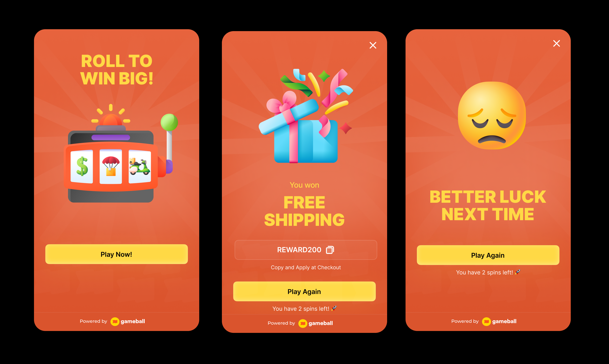
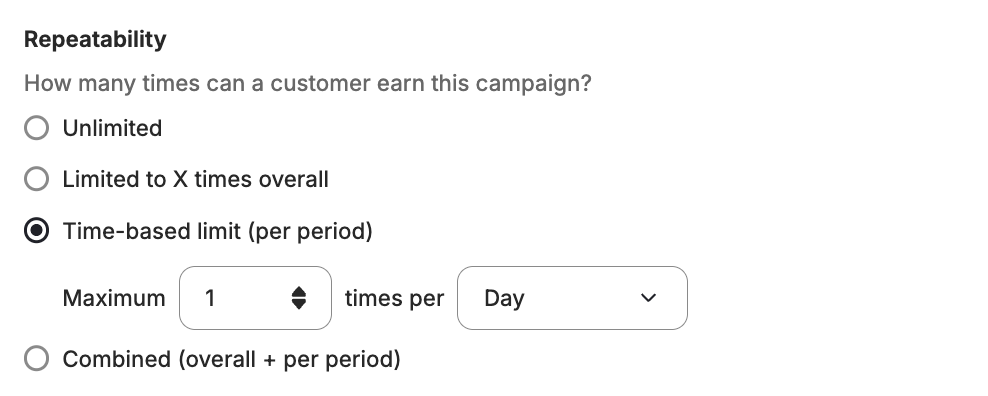
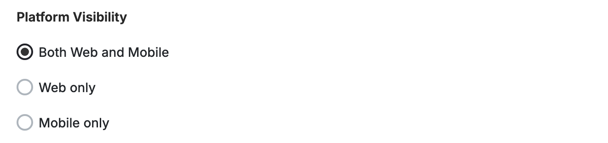
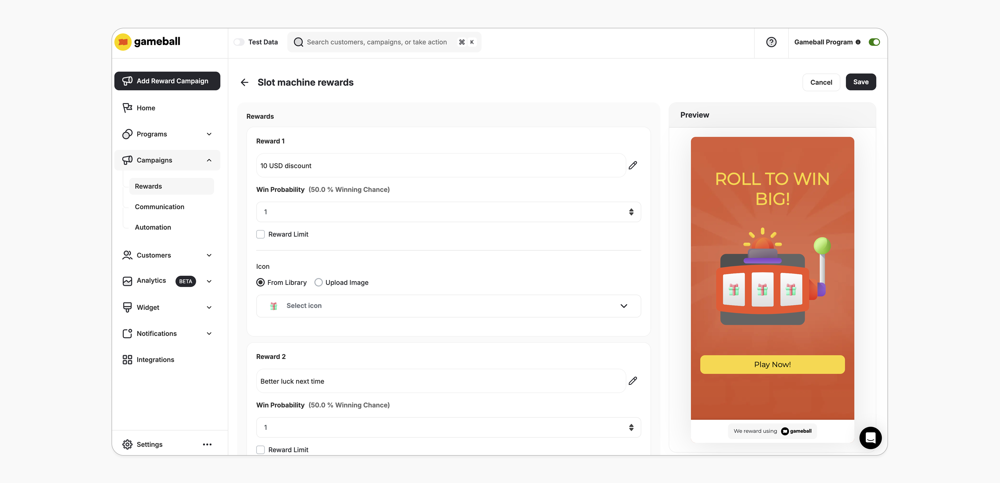
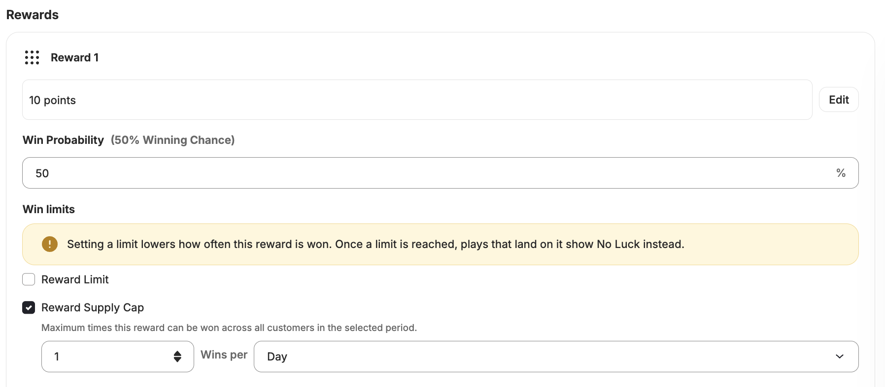
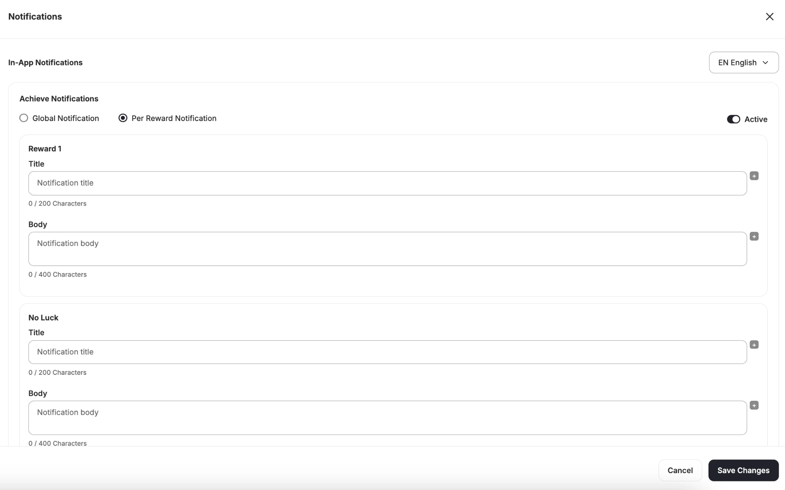
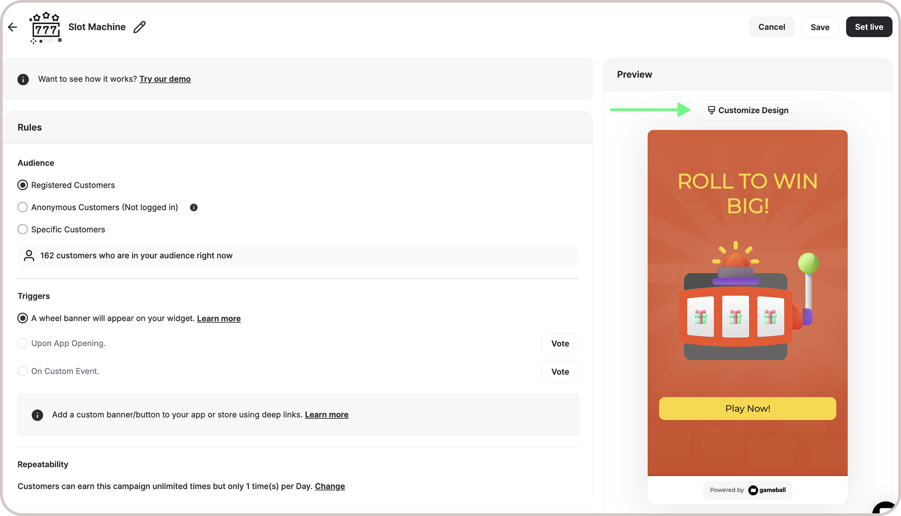
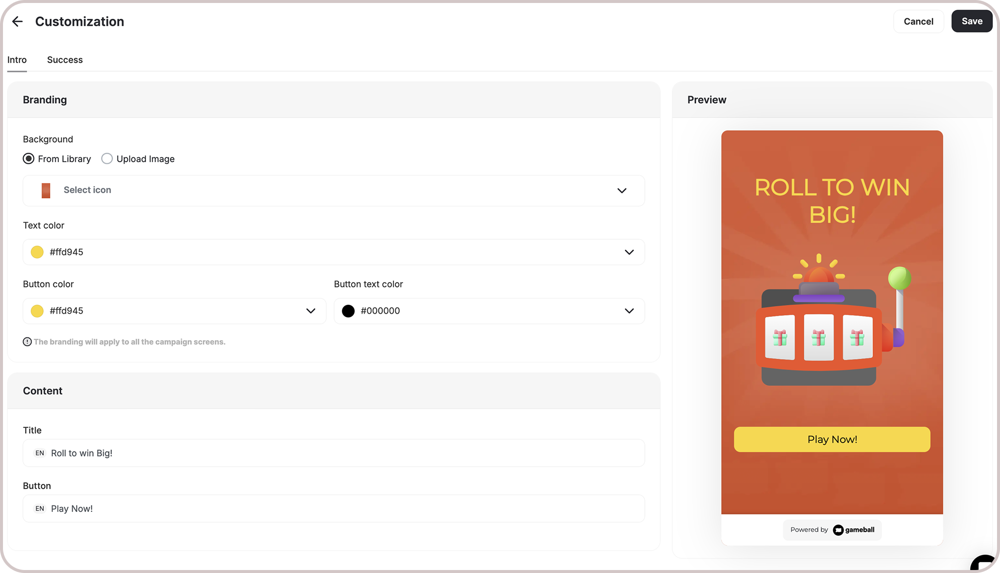
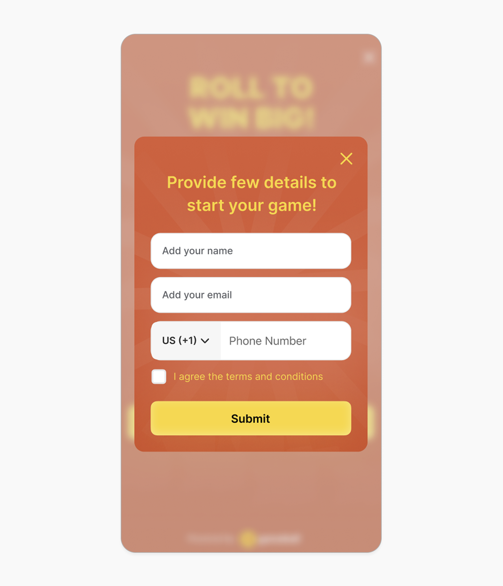

## Plan Availability

<Tabs>
<Tab title="Shopify & Salla">
| Plan | Available |
|---|---|
| Starter | Yes |
| Pro & Guru | Yes |
</Tab>

<Tab title="Non-Platform">
| Plan | Available |
|---|---|
| Add-on | Yes |
</Tab>
</Tabs>

Add excitement to your customer experience with the Slot Machine campaign. This gamified feature lets customers try their luck -- if all three slots align, they win a prize! From discounts and free products to bonus points, the rewards keep them coming back.

<Frame>
  
</Frame>

---

## Creating a Slot Machine Campaign

<Steps>
<Step title="Open Gameball and Create Campaign">
  Open Gameball and click **Add Reward Campaign**.
</Step>

<Step title="Select the Template">
  Select the **Slot Machine** template.
</Step>

<Step title="Edit Campaign Setup">
  Edit the campaign's setup (see configuration sections below).
</Step>

<Step title="Go Live">
  Click **Set Live** to activate the campaign.
</Step>
</Steps>

---

## Campaign Configuration

<AccordionGroup>
<Accordion title="Trigger" icon="bolt">
  - **Machine Banner on Widget:**
    A banner will display on your widget's homepage. When customers click the banner, they'll be taken to the game screen where they can roll the machine.

  - **Deep Link:**
    Use the `#gameball-slot` deep link to trigger the slot machine campaign from a custom banner or button on your website or app. [Learn more](/product-documentation/rewards-campaigns/start-from-scratch/setup-reward-campaign).

  - **App Popup:**
    Open the game by itself inside your mobile app when the app opens or a custom event happens. Not available for campaigns set to Web only. [Learn more](/product-documentation/rewards-campaigns/launch-game-campaign-app-popup).
</Accordion>

<Accordion title="Audience" icon="users">
  - **Registered Customers:**
    Customers who have an account on your platform (signed up)

  - **Anonymous Customers:**
    Visitors browsing anonymously without providing any contact information or identifiable details (not signed up)

    <Note>
    - Visitors can open the game, submit basic information through the lead form, play, and receive rewards, matching the standalone game URL experience.
    - Widget deep links that open a specific game work for guests as well. The widget would open directly into the game screen and allow participation without login.
    </Note>

  - **Specific Customers:**
    You can choose for a specific selection of customers to participate in this campaign by filtering using segments, tags or customer attributes.
</Accordion>

<Accordion title="Repeatability" icon="repeat">
  Control how many times a customer can play the game:

  | Option | Description |
  |---|---|
  | **Unlimited** | Customers can play as many times as they like. |
  | **Limited to X times overall** | Caps the total number of plays per customer for the lifetime of the campaign. |
  | **Time-based limit (per period)** | Sets a maximum number of plays per day, week, or month. The counter resets at the start of each period based on your account timezone. |
  | **Combined (overall + per period)** | Applies both an overall cap and a per-period cap. Whichever limit is reached first blocks the next play. |

  <Frame>
    
  </Frame>

  <Note>
  Raising a limit on a live campaign makes customers eligible to play again immediately.
  </Note>
</Accordion>

<Accordion title="Platform Visibility" icon="desktop">
  You can choose whether the game campaign is shown on web, mobile, or both, giving you better control over engagement strategies across platforms.

  <Frame>
    
  </Frame>
</Accordion>
</AccordionGroup>

<Info>
This template uses the standard reward campaign setup. See the [Generic Setup Guide](/product-documentation/rewards-campaigns/start-from-scratch/setup-reward-campaign) for details.
</Info>

---

## Rewards Setup

<Frame>
  
</Frame>

<AccordionGroup>
<Accordion title="Reward Types" icon="tag">
  Choose from any of the reward types supported by Gameball. [Learn more](/product-documentation/rewards-campaigns/start-from-scratch/setup-reward-campaign).

  | Setting | Value |
  |---|---|
  | Minimum rewards allowed | 2 |
  | Maximum rewards allowed | 8 |
</Accordion>

<Accordion title="Probability" icon="dice">
  Enter a numerical value (e.g., 2, 3, 4) to represent the probability of a customer receiving this reward. Every spin is completely independent of the previous ones, and the chance of landing on a specific reward is always the same, no matter how many times the machine has been rolled.

  - The probability input can accept a value of 0, meaning the reward will not be available.
  - Probabilities are calculated based on the sum of all assigned probabilities across the rewards.

  <Warning>
  While each reward has a set probability, it doesn't guarantee that all rewards will be won equally over time. Some rewards might appear more often, while others might be less frequent. It's all part of the random nature of the game!
  </Warning>

  **Example:**
  - Reward #1: Probability 1
  - Reward #2: Probability 1
  - Reward #3: Probability 1

  After 100 trials, you might see results like this:
  - Reward #1: 27 times
  - Reward #2: 36 times
  - Reward #3: 37 times
</Accordion>

<Accordion title="Reward Limits" icon="lock">
  The maximum number of times a specific reward can be claimed by all customers throughout the campaign.

  - **Optional Feature:** You can choose to add a reward limit when configuring the campaign.
  - **Tracking Wins:** Gameball will track how many times each reward has been won. After the limit is reached, the reward will still appear on the machine but will no longer be winnable.
  - **Reward Limit Adjustment:**
      - **Increase the Limit:** If the new limit is higher, customers can win the reward again.
      - **Decrease the Limit:** If the new limit is lower, the system will prevent the reward from being won if the initial limit was already reached.

  **Example:**
  - Reward 1: Probability 1, Limit: 1
  - Reward 2: Probability 1, No Limit
  - Reward 3: Probability 1, No Limit

  After 10 trials: Reward 1 hits 1 win (limit reached), Reward 2 hits 5 wins, Reward 3 hits 4 wins.

  <Note>
  If all rewards have limits and they are reached, customers will see a "No rewards available at the moment" message.
  </Note>
</Accordion>

<Accordion title="When a Reward Reaches Its Limit" icon="scale-balanced">
  When a reward reaches its limit, you choose what happens. The setting is at the top of the rewards page and applies to every reward in the campaign that has a **Reward Limit** or **Reward Supply Cap**.

  - **Show No Luck instead:** Plays that land on the reward show No Luck. The other rewards keep the probability you set.
  - **Share its probability with the other rewards:** The reward leaves the draw, and its probability is shared among the other rewards, No Luck included.
</Accordion>

<Accordion title="Reward Supply Cap" icon="gauge">
  Control how many times a reward can be won across all customers in a given period, without changing its odds.

  - Set a **daily**, **weekly**, or **monthly** cap per reward.
  - When the cap is reached, what happens next depends on your **When a reward reaches its limit** setting: by default, plays that land on that reward show **No Luck** instead and the odds you set stay the same.
  - A **No Luck** reward is added automatically whenever any reward has a supply cap, and cannot be removed while caps exist.
  - Customers never see that a reward is capped.

  <Frame>
    
  </Frame>

  <Note>
  The Reward Supply Cap works alongside the per-customer Reward Limit — both can be set on the same reward at the same time.
  </Note>
</Accordion>
</AccordionGroup>

---

## End User Experience

**How it works:**

<Steps>
<Step title="Roll the Machine">
  Customers earn rewards through rolling the machine.
</Step>

<Step title="Match All Three Windows">
  If all three windows match, they win a reward.
</Step>

<Step title="Receive a Prize">
  Prizes can include discounts, free items, bonus points, and more.
</Step>

<Step title="Get Notified">
  The customer is notified via the widget or email, depending on your configuration when they earned a reward. [Learn more](/product-documentation/rewards-campaigns/start-from-scratch/setup-reward-campaign).
</Step>
</Steps>

---

## Notifications

You can send a different notification for each reward outcome — including No Luck — instead of one generic message for the whole campaign.

In the campaign's **Notifications** settings, choose between:

- **Global Notification** — one message sent regardless of which reward the customer won.
- **Per Reward Notification** — a separate title and body for each reward, plus a dedicated card for No Luck.

<Frame>
  
</Frame>

Both in-app and email notifications can be set independently to Global or Per Reward.

<Note>
The campaign overview warns you when only some rewards have an email configured, so you know exactly which outcomes will send one.
</Note>

---

## Customization

You can fully customize each stage of the campaign through dedicated tabs representing the different screens in the flow:

<Tabs>
<Tab title="Banner">
  Configure the banner that appears in the widget to promote the Slot Machine campaign.
</Tab>

<Tab title="Intro / Main Screen">
  Set up the main game screen with headlines, descriptions, and call-to-action messages.
</Tab>

<Tab title="Lead Form">
  Shown when audience is set to **Anonymous Customers (Not logged in)**. Collect visitor information before gameplay.
</Tab>

<Tab title="Success Screen">
  Customize the message and visuals shown when a customer wins.
</Tab>

<Tab title="No Luck Screen">
  Configure the message shown when a customer does not win.
</Tab>
</Tabs>

For each screen, you can tailor:

- **Branding**: Adjust background colors, text colors, and upload custom artworks.
- **Content**: Edit the headlines, descriptions, and call-to-action messages to match your tone and messaging.

<Frame>
  
</Frame>

<Frame>
  
</Frame>

---

## Important Notes

### Fraud Prevention

In the "Slot Machine" campaigns for guests (**Audience is Anonymous/Not Logged-in**), the following protections apply:

| Protection | Description |
|---|---|
| **Single Play Per Session** | Guest users can try the game only once per session. If they attempt to re-enter, a message displays: "You have already spun the Machine." |
| **Multiple Machines in Campaign** | For campaigns with multiple machines, this restriction applies individually to each machine. Guests can still roll any other machine they haven't tried. |
| **Session Restriction** | If a guest opens a new browser tab or window after playing, the same restriction message will appear. |

<Note>
**Customer Eligibility**

Games in the widget update dynamically based on customer eligibility, ensuring customers only see games they can still participate in.

**Games are hidden when customers become ineligible.**

If a customer no longer belongs to the game's target segment, the game is automatically removed from the widget and won't reappear unless eligibility is restored.
</Note>

### Anonymous Option

- If you choose **Anonymous** as the audience, the campaign will be available to visitors who are not yet identified on your store.
- Once enabled, a lead form will automatically appear prompting the customer to enter their information (e.g. name, email).
- This is a great way to collect leads and retarget potential customers later.
- You can fully customize this form by navigating to **Customize Design -> Lead Form**.

<Frame>
  
</Frame>

<Tip>
Customizing the lead form also allows you to add a hyperlink to the **"terms and services"** so that customers can read and accept them before clicking submit.
</Tip>

---

## Related Articles

<CardGroup cols={2}>
<Card title="Set Up a Reward Campaign" icon="gift" href="/product-documentation/rewards-campaigns/start-from-scratch/setup-reward-campaign">
  Learn the full setup process for creating and activating reward campaigns.
</Card>

<Card title="Reward Types in Gameball" icon="tag" href="/product-documentation/rewards-campaigns/start-from-scratch/setup-reward-campaign">
  Explore all reward types available and how to configure each one.
</Card>

<Card title="Notification After Earning a Reward" icon="bell" href="/product-documentation/rewards-campaigns/start-from-scratch/setup-reward-campaign">
  Configure in-app and email notifications triggered when customers earn rewards.
</Card>
</CardGroup>
