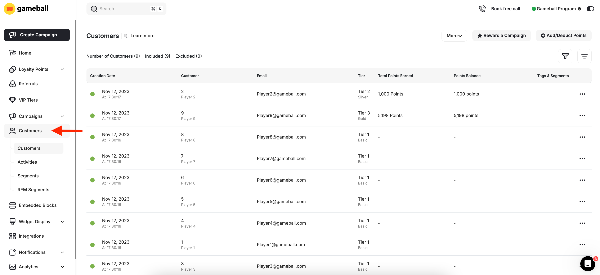
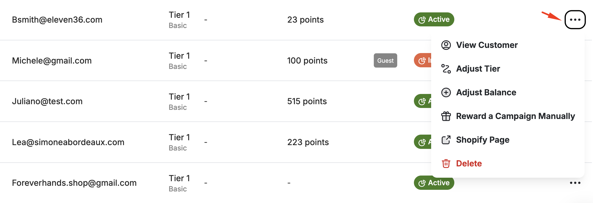
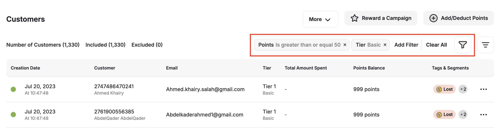
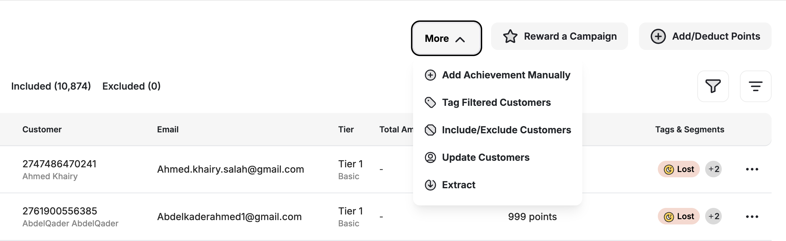
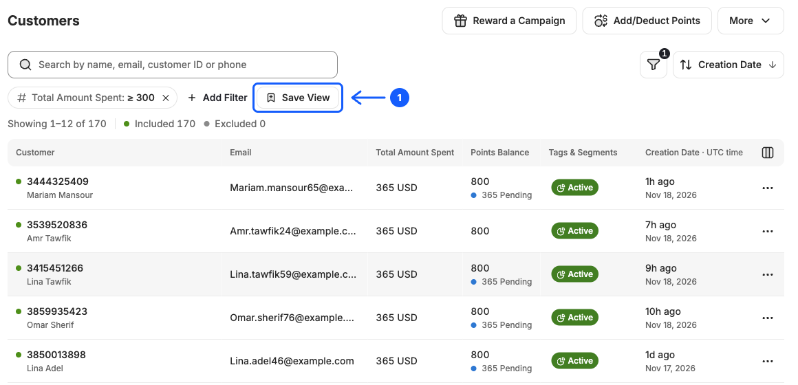
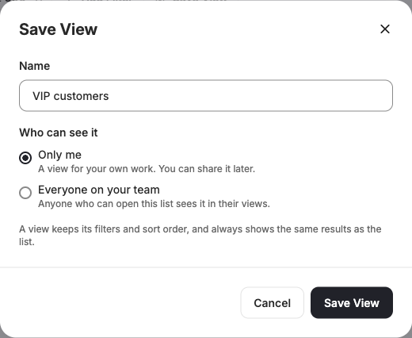
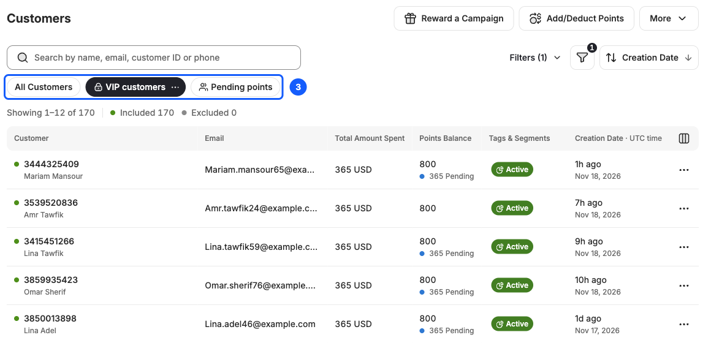
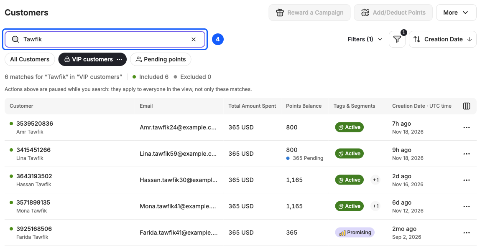
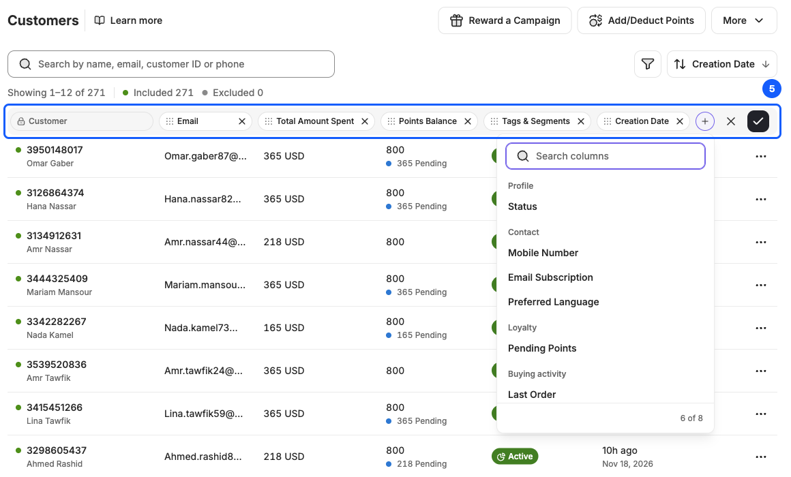
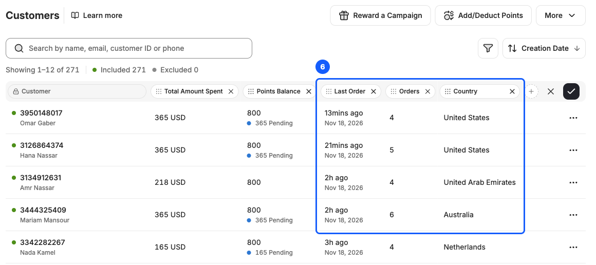

You can access your **Customers** tab through the **Gameball Admin Dashboard**.

<Frame>
  
</Frame>

---

## Customer List Overview

Once you access the **Customers** tab on your Gameball dashboard, you will see a list of all customers along with key profile attributes that help you better understand and manage each customer's engagement level.

### Understand the Columns in the Customer List

| Column | Description |
| --- | --- |
| **Creation Date** | The date and time the customer profile was created in Gameball. |
| **Customer** | Displays the customer's full name and their unique Gameball ID. |
| **Customer Email** | The registered email address associated with the customer. |
| **VIP Tier** | The current tier of the customer based on your configured loyalty program. This includes both the tier order and tier name. |
| **Score / Total Amount Spent / Total Points Earned** | This column varies depending on your configured tiering-up method: if based on **Score**, this shows the current score; if based on **Amount Spent**, it shows cumulative spend; if based on **Points**, it shows the total points earned. You can learn more about the [Tiering-up methods](/product-documentation/programs/vip-tiers/tier-settings/tiering-up-methods). |
| **Points Balance** | Displays two types of points: **Active Points** (redeemable points currently available) and **Pending Points** (non-redeemable points awaiting the completion of the configured return window). Learn more about [Pending Points and Return Window](/product-documentation/programs/loyalty-points-earn/launch-and-configure-your-earn-pointing-system). |
| **Guest Tag** | Indicates that the customer placed an order as a guest and has not yet created an account on your platform. This tag is automatically displayed if the customer's status is identified as a guest. The [guest customers](/product-documentation/guides-strategies-faqs/supportive-guides/integrate-guest-customers) feature is available by default in Shopify or through custom integration with Gameball. |
| **Tags and Segments** | Lists any tags manually added to the customer, and the segments they belong to, based on dynamic rules or RFM logic. |

You can show, hide, and reorder these columns, and add others, as described in [Save Views and Choose Your Columns](#save-views-and-choose-your-columns).

### Actions Available on Each Row

<Frame>
  
</Frame>

Each customer in the list has a quick action menu that allows you to perform individual updates or actions directly from the list view. Here are the available actions:

| Action | Description | Availability |
| --- | --- | --- |
| **View Customer** | Opens the detailed customer profile page, where you can review full data, points history, events, and more. | All platforms |
| **Adjust Tier** | Manually update the customer's VIP tier. This allows you to override the default tiering logic when needed. | All platforms |
| **Adjust Balance** | Manually add or deduct points from the customer's current balance. | All platforms |
| **Reward a Campaign Manually** | Manually reward a customer with a configured campaign. Useful for ad-hoc or support-related rewards. | All platforms |
| **Shopify Page** | Opens the customer's profile directly within your Shopify admin. | Shopify only |
| **Delete** | Permanently deletes the customer profile from Gameball. This option is **not available for Shopify or Salla integrations**. | Non-platform clients only |

---

## Customers Page-Level Actions

This section covers how to filter your customer list and how to apply single actions and bulk actions to one or more selected customers.

### Apply Filters to Refine the View

<Frame>
  
</Frame>

You can use filters to narrow down the customer list based on specific attributes or behavioral data. Multiple filters can be applied at the same time for more advanced segmentation.

<Steps>
  <Step title="Open the filter panel">
    Click the **Filter** icon at the top of the Customers page.
  </Step>
  <Step title="Select filter options">
    Select from the available filter options listed below.
  </Step>
  <Step title="Define your criteria">
    Define your criteria (e.g., ranges, keywords, status).
  </Step>
  <Step title="Apply the filter">
    Click **Apply Filter** to view only the customers matching your selected criteria.
  </Step>
</Steps>

#### Available Filters

| Filter | Description |
| --- | --- |
| **Creation Date** | Filter by the date the customer was added to Gameball. |
| **Customer Type** | Filter between registered users and guests. |
| **Customer ID** | Search for a specific customer using their unique ID. |
| **Customer Name** | Search by full name. |
| **Customer Email** | Filter by email address. |
| **Customer Phone Number** | Filter by mobile number. |
| **Total Amount Spent** | Filter customers based on how much they've spent in total (or based on your configured tiering-up method). |
| **Points** | Filter by current total points. |
| **Pending Points** | Filter customers based on points currently in a pending state. |
| **Included** | Filter by inclusion or exclusion from your loyalty program. |
| **Tags** | Filter by one or more tags applied to customers. |
| **Segments** | Filter based on the customer's assigned dynamic segments. |
| **RFM Segments** | Filter by customers' RFM segments. |
| **Tier** | Filter by current VIP tier. |

<Note>
All applied filters will remain active until you manually reset or remove them. The customer list and any bulk actions will reflect only the filtered results.
</Note>

### Perform Bulk Actions

<Frame>
  
</Frame>

You can apply actions to multiple customers simultaneously. This is useful when managing a filtered segment or performing large-scale updates.

<Warning>
If a filter is applied, bulk actions will be applied **only to the filtered customers** currently visible in the list.
</Warning>

#### Available Bulk Actions

| Action | Description |
| --- | --- |
| **Reward a Campaign** | Manually assign a configured reward campaign to all selected customers. This is useful for delivering one-time rewards or campaign incentives in bulk instead of waiting for the customer to accomplish the reward campaign rules. |
| **Add/Deduct Points** | Directly adjust the points balance of selected customers by adding or deducting points. Useful for corrections or manual point rewards. |
| **Tag Filtered Customers** | Apply one or more tags to the selected customers for future targeting or segmentation. |
| **Include/Exclude Customers** | Bulk include or exclude selected customers from your Gameball loyalty program. |
| **Update Customers** | Update customer data in bulk via CSV. Labeled **"Update Customers"** on Shopify/Salla to update existing customer data. Labeled **"Update/Migrate Customers"** on non-platform integrations to support customer migration and updates. Customer creation and deletion are not allowed through Gameball for Shopify or Salla users -- these operations must be handled through the platform, and Gameball will sync automatically. |
| **Extract** | Export the filtered customer list to a CSV file, including detailed fields beyond those shown on screen. Read more about this through [Export Your Customer List](/product-documentation/understanding-your-customers/your-customers/export-your-customer-list). |

<Note>
1. You cannot delete customers in bulk.
2. There are some other bulk actions you can apply using the [batch creation API](/api-reference/batches/batch-creation).
</Note>

---

## Save Views and Choose Your Columns

A **saved view** stores the filters and sort order of your Customers list under a name, so you can reopen the same group of customers in one click. You can keep a view to yourself or share it with your whole team. Each view also keeps its own columns.

### Save a View

<Steps>
  <Step title="Filter the list, then choose Save View">
    Apply the filters and sort order you want, then click **Save View**.

    <Frame>
    
    </Frame>
  </Step>
  <Step title="Name the view and choose who can see it">
    Enter a name for the view and choose whether to keep it to yourself or share it with everyone on your team.

    <Frame>
    
    </Frame>
  </Step>
  <Step title="Open any of your views in one click">
    Select a view to see the customers who match it right now. You can set a default view that opens with the list.

    <Frame>
    
    </Frame>
  </Step>
  <Step title="Search inside the open view">
    Search the customers in the open view by name, email, customer ID, or phone number.

    <Frame>
    
    </Frame>
  </Step>
</Steps>

<Note>
You can save up to 50 views each. {/* TODO: confirm whether the 50-view limit applies per team member and whether it counts shared views */}
</Note>

### Choose Your Columns

Choose which columns the list shows, and in what order, right in the table header. Each saved view keeps its own columns.

<Steps>
  <Step title="Edit the columns in the table header">
    Drag a column to reorder it, or hide a column you do not need.

    <Frame>
    
    </Frame>
  </Step>
  <Step title="Add the columns you need">
    Add extra columns such as status, last order, total spent, redemptions, referral code, and country.

    <Frame>
    
    </Frame>
  </Step>
</Steps>

Saved views and column controls also work on the [Communication](/product-documentation/communication-campaigns/introduction-to-communication-campaigns#manage-your-campaign-list) and [Automations](/product-documentation/automation-campaigns/how-to-create-an-automation-campaign#manage-your-automation-list) lists. The [Reward Campaigns](/product-documentation/rewards-campaigns/reward-campaign-general-setup-guide#manage-your-campaign-list) list supports column controls.

---

## Related Articles

<CardGroup cols={2}>
  <Card title="Export Your Customer List" icon="file-export" href="/product-documentation/understanding-your-customers/your-customers/export-your-customer-list">
    Export your customer data to a CSV file with detailed fields.
  </Card>
  <Card title="Customer Activity Log" icon="list-timeline" href="/product-documentation/understanding-your-customers/your-customers/customer-activity-log">
    Track all customer transactions and activities.
  </Card>
  <Card title="Group Customers by Tags" icon="tags" href="/product-documentation/understanding-your-customers/customer-profile/group-your-customers-by-tags">
    Use tags to manually group and target customers.
  </Card>
  <Card title="Explore a Customer Profile" icon="user" href="/product-documentation/understanding-your-customers/customer-profile/explore-and-manage-a-customer-profile">
    View and manage individual customer data.
  </Card>
</CardGroup>
